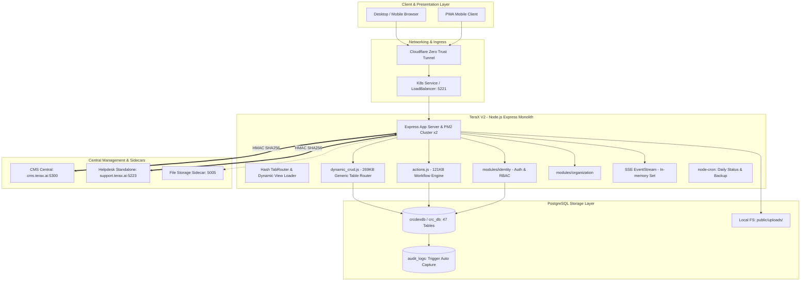
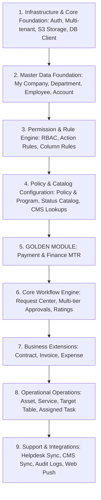

# 00 — EXECUTIVE SUMMARY: TERAX V2 FULL SYSTEM AUDIT FOR V3 MIGRATION

> **Target System:** TeraX V2 (formerly CRC App / `rqc_mps`)  
> **Source Directory:** `D:\CPI\teraxV2`  
> **Target Migration Destination:** `D:\CPI\teraxV3`  
> **Audit Date:** October 2026  
> **Audit Mode:** Strict Read-Only Analysis (Zero Code Modifications)

---

## 1. Stack Hiện Tại

| Thành phần | Công nghệ hiện tại (V2) | Đánh giá & Rủi ro |
|---|---|---|
| **Runtime & Language** | Node.js v20 (Alpine), CommonJS (`require`) | Ổn định, nhưng CJS cũ cần nâng cấp ESM/TypeScript trong V3. |
| **Backend Framework** | Express 4.18.2 | Monolithic router, thiếu dependency injection, thiếu routing type-safety. |
| **Frontend Architecture** | Vanilla HTML5 / ES6 Vanilla JS / Custom Tab Router SPA | Không dùng React/Vue. Toàn bộ logic DOM do `app.js` và `public/js/views/*` xử lý thủ công. |
| **Styling & Design System** | Vanilla CSS (`public/style.css` - 191KB, ~7,255 dòng) | Không dùng Tailwind. Hàng chục breakpoint không đồng nhất (`400px` đến `1200px`), CSS dùng chung nhiều biến cục bộ. |
| **Database** | PostgreSQL 15/16 | 47 bảng, chứa cả data relational và JSONB workflows (`approval_flow`, `log`, `features`). |
| **ORM / Query Layer** | `pg` (node-postgres) trực tiếp + Custom Dynamic Query Builder | Không dùng ORM. Toàn bộ SQL là raw parameterized query hoặc chuỗi nối động trong `dynamic_crud.js`. |
| **Authentication** | JWT (`jsonwebtoken`) + `bcryptjs` + Google OAuth (`google-auth-library`) | Token có hạn lên tới **365 ngày** (`expiresIn: '365d'`), không có Refresh Token rotation. |
| **Authorization / RBAC** | Dynamic Multi-dimension Rules: `action_rules`, `exception_rules`, `column_permissions` | Quản lý phân quyền 4 chiều (Role, Level, Position, Exception) trực tiếp từ database. Super Admin bypass toàn bộ. |
| **Realtime Sync** | Server-Sent Events (SSE) via `/api/stream` | Bộ nhớ biến cục bộ `clients = new Set()`, không hỗ trợ multi-instance (PM2 cluster hoặc multi-pod K8s bị mất sync). |
| **Background Jobs & Cron** | `node-cron` v4.2.1 | 2 cron nội bộ chạy lúc 00:00 (due date outgoing payments) và 01:00 (xoay vòng backup database). |
| **External Integrations** | CMS Central (`cms.terax.ai`), Helpdesk (`support.terax.ai`), Cloudflare Tunnel (`cloudflared`) | Tích hợp qua HMAC SHA-256 signatures; đồng bộ 2 chiều qua REST API. |
| **File Storage** | Local Disk (`public/uploads`) + HTTP Sidecar fallback (`http://127.0.0.1:5005`) | Lưu trữ tệp trên disk cục bộ của container, nguy cơ mất tệp khi pod restart nếu không có PVC. |
| **Container & Orchestration** | Dockerfile (Node 20 Alpine + PM2 runtime -i 2), Kubernetes YAMLs (`k8s-manifest.yaml`) | Đã có manifest K8s, Service LoadBalancer, Dozzle log monitoring. |

---

## 2. Kiến Trúc Hệ Thống (Architectural Topology)

---

## 3. Các Phân Hệ & Module Chính

Hệ thống quản lý 15 domain nghiệp vụ chính:

1. **Identity & Access Control (`modules/identity`):** Xác thực tài khoản, phân quyền cột, phân quyền menu, phân quyền action.
2. **Organization (`modules/organization`):** Quản lý pháp nhân công ty (`my_company`), phòng ban (`department`), nhân sự (`employee`), chi nhánh văn phòng (`my_location`), đối tác khách hàng/nhà cung cấp (`company`), đầu mối liên hệ (`contact`).
3. **Request Management (`modules/request`):** Trái tim của hệ thống: Tiếp nhận yêu cầu (SR), quy trình phê duyệt đa cấp (Tier 0 đến Tier 3), đánh giá sao (`request_rating`), theo dõi người liên quan (`request_watches`), bình luận trao đổi gắn tag (`comment`).
4. **Finance & Payment (`modules/payment`, `modules/finance`):** Lập phiếu thanh toán Incoming/Outgoing, tích hợp đối soát ngân hàng (`mtr`), quản lý tài khoản ngân hàng (`account`), sinh tự động yêu cầu thanh toán (`payment_req_outgoing`).
5. **Invoice Management (`modules/invoice`):** Quản lý hóa đơn VAT, tính toán thuế, tự động sinh hóa đơn khi hợp đồng bán (Selling) hoàn tất thanh toán.
6. **Expense Tracking (`modules/expense`):** Quản lý chi phí doanh nghiệp phân loại theo Operation Cost, Sales Cost, Fixed/Variable Cost.
7. **Contract Management (`modules/contract`):** Hợp đồng Buying, Selling, Internal; liên kết chặt chẽ với Request, Payment và Invoice.
8. **Asset Management (`modules/asset`):** Quản lý tài sản trang thiết bị văn phòng, khấu hao, phân bổ người sở hữu hiện tại (`current_owner`).
9. **Service Management (`modules/service`):** Quản lý dịch vụ thuê ngoài, gia hạn hàng năm (Annual Renew), phần mềm trả phí định kỳ (Subscription).
10. **Target Table (`modules/target_table`):** Quản lý chỉ tiêu doanh số/KPI theo chu kỳ.
11. **Task Subsystem (`assigned_task`, `task_subtask`):** Giao việc tự động từ bước `Start` của Request, quản lý deadline, báo cáo hoàn thành qua giao diện Kanban.
12. **Support & Helpdesk (`modules/support`):** Tiếp nhận ticket hỗ trợ, đồng bộ 2 chiều sang hệ thống Helpdesk trung tâm (`support.terax.ai`).
13. **Policy & Process Setup (`policy_and_program`, `operation_program`):** Định nghĩa SLA, cấp duyệt mặc định, trưởng quy trình (`policy_lead`), đội ngũ xử lý (`sr_owner`).
14. **System Setup & Automation (`system_setup`, `automation_registry`):** Wizard khởi tạo doanh nghiệp mới và quản lý bật/tắt trigger tự động hóa.
15. **Audit & Activity Logs (`audit_logs`, `automation_run_logs`):** Nhật ký biến động dữ liệu toàn hệ thống do DB trigger tự động ghi.

---

## 4. Database & Storage Architecture

- **PostgreSQL Schemas:** Hệ thống chạy trên schema `public` gồm **47 bảng**.
- **Chế độ Audit Data:** Các cột cũ (`created_by`, `updated_by`, `created_date`, `updated_date`) đã bị loại bỏ; toàn bộ thao tác INSERT/UPDATE/DELETE được bắt bởi trigger `audit_log_trigger()` và ghi vào bảng `audit_logs` (lấy user từ `current_setting('app.current_user')`).
- **Cascade Soft Delete Trigger:** Hàm `cascade_soft_delete_trigger()` tự động lắng nghe khi cột `deleted_at` của bảng cha thay đổi từ `NULL` sang `timestamp`, sau đó đệ quy gán `deleted_at = CURRENT_TIMESTAMP` cho các bảng con liên kết.
- **Ràng buộc khóa ngoại (Foreign Keys):** Rất ít foreign key constraint ở cấp độ DDL. Hầu hết liên kết giữa các bảng là **Logical Foreign Keys** (ví dụ `payment.request -> request.request_id`).
- **File Storage:** File đính kèm và ảnh avatar được base64 upload, tự động giải mã và ghi xuống thư mục vật lý `public/uploads/` trên disk, hoặc chuyển qua Sidecar Container port 5005.

---

## 5. Authentication & Authorization (RBAC)

1. **Authentication Flow:**
   - Hỗ trợ 2 phương thức: Mật khẩu (`bcryptjs` hash) và Google OAuth / Centralized SSO qua `cms.terax.ai`.
   - Cơ chế tạo token: `jwt.sign(payload, JWT_SECRET, { expiresIn: '365d' })`.
   - **Lỗ hổng bảo mật nghiêm trọng phát hiện trong audit:** Endpoint `POST /api/auth/switch-user` cho phép bất kỳ user nào đã đăng nhập chuyển đổi sang bất kỳ tài khoản nhân viên nào khác chỉ với `employee_id` mà **không kiểm tra quyền Super Admin**.
2. **RBAC Flow:**
   - Bảng `exception_rules`: Phân quyền hiển thị Menu / View.
   - Bảng `action_rules`: Phân quyền thực hiện action (Thêm, Sửa, Xóa, Duyệt, Chuyển quyền). Hỗ trợ cú pháp dot-notation dynamic roles như `[request.sr_owner]`, `[request.policy_lead]`.
   - Bảng `column_permissions` (kết hợp `permission_levels`, `permission_positions`, `permission_roles`, `permission_exceptions`): Ẩn/hiện cột nhạy cảm theo cấp bậc, chức vụ, vai trò hoặc danh sách ngoại lệ.

---

## 6. Workflow Engine

Hệ thống sở hữu máy trạng thái (State Machine) phức tạp kết hợp cả DB-Trigger và Application Code:
- **Request Lifecycle:** `Draft (1)` $\rightarrow$ `Pending Approval (2)` $\rightarrow$ `Approved (3)` $\rightarrow$ `Closed (5)` hoặc `Rejected (4)` / `Cancelled (6)`.
- **Process Status:** `Not started yet (7)` $\rightarrow$ `Processing (8)` $\rightarrow$ `Completed (9)` / `Canceled (117)`.
- **Quy trình Duyệt Đa Tầng:** Cấu trúc JSONB `approval_flow` lưu trữ danh sách các bước duyệt (`steps: [{ level, approver, status, action_by, action_date }]`). Khi cấp trước duyệt, cấp tiếp theo mới chuyển sang `Pending`.
- **Tự Động Hóa Liên Bảng:**
  - Duyệt yêu cầu thanh toán (`request_type = '5'`) $\rightarrow$ tự động đổi trạng thái Payment sang `Ready for payment (31)` và auto-complete Request.
  - Thanh toán thành công (`payment_paid`) trên hợp đồng bán (Selling) $\rightarrow$ tự động sinh bản ghi Hóa đơn (`invoice`) trạng thái `Paid` và tự động tính toán thuế VAT / tỷ giá.
  - Bắt đầu Request (`ACT-REQUEST-08`) $\rightarrow$ tự động sinh công việc (`assigned_task`) cho từng nhân sự trong danh sách giao việc và bắn thông báo Push/In-app.

---

## 7. UI / Frontend Architecture

- **SPA Không Dùng Build Tool:** Chạy trực tiếp từ file tĩnh HTML/JS thông qua Express static file serving.
- **Config-Driven UI:** Cấu trúc form, danh sách cột, kiểu dữ liệu, quan hệ lookup đều được định nghĩa trong `public/js/config/modules/*.config.js` (`MODULES`).
- **Custom Tab Router:** Hỗ trợ người dùng mở nhiều tab cùng lúc như trình duyệt web, lưu trữ trạng thái scroll và DOM node trong bộ nhớ giúp chuyển tab mượt mà với độ trễ 0ms.
- **Local State Array:** Dữ liệu danh sách được giữ trong biến toàn cục `currentData` và `dashboardData`. Sau khi gọi API action thành công, code tự splice/merge dữ liệu mới vào mảng để tránh reload toàn bộ trang.

---

## 8. Top 5 Technical Debt Nghiêm Trọng Nhất

1. **God Files khổng lồ:**
   - `server/routes/dynamic_crud.js`: **5,526 dòng** (~269KB).
   - `public/style.css`: **7,255 dòng** (~191KB).
   - `server/db.js`: **3,662 dòng** (~194KB) chứa toàn bộ script migration DDL chạy khi start server.
   - `server/routes/actions.js`: **2,506 dòng** (~121KB).
2. **Lỗ hổng bảo mật Switch User & Thời hạn Token quá dài:**
   - Endpoint `/api/auth/switch-user` không ràng buộc quyền.
   - Token tồn tại 365 ngày mà không có cơ chế thu hồi (Revocation list) hoặc Refresh Token.
3. **Mã nguồn rác / File Route không được mount:**
   - 8 file route cũ trong `server/routes/` (`auth.js`, `company.js`, `department.js`, `employee.js`, `contact.js`, `myCompany.js`, `permissions.js`, `notifications.js`) bị bỏ rơi không mount trong `server/index.js` sau khi tách ra `modules/`.
   - File cấu hình client bị nhân bản 2 nơi: `modules/*/client/*.config.js` và `public/js/config/modules/*.config.js`.
4. **Trạng thái Realtime (SSE) và In-Memory Cache cục bộ:**
   - Danh sách kết nối SSE `clients` và cache quyền `_userReqIdsCache` nằm hoàn toàn trong RAM của tiến trình Node.js đơn lẻ. Chạy PM2 cluster (`-i 2`) hoặc K8s nhiều pod sẽ dẫn đến mất đồng bộ realtime giữa các người dùng.
5. **Lưu trữ File phụ thuộc Local Filesystem:**
   - Tệp upload lưu tại `public/uploads/` trên container. Nếu container bị restart hoặc chạy nhiều bản sao (replica), tệp sẽ bị mất hoặc không thể truy cập chéo giữa các container.

---

## 9. Top 5 Migration Risks

1. **Rủi ro đứt gãy quy trình tự động hóa ngầm:** Các trigger trong Database (`trg_cascade_soft_delete`, `trg_request_submit_status`, `trg_sync_payment_request`) và logic ngầm trong `actions.js` có sự phụ thuộc chéo rất chặt chẽ. Nếu migrate thiếu một trigger, luồng trạng thái sẽ bị nghẽn.
2. **Rủi ro vỡ giao diện do phụ thuộc Config-Driven UI:** UI hiện tại phụ thuộc tuyệt đối vào object `MODULES`. Khi viết lại UI bằng React/Next.js trong V3, nếu không có Design System hoàn chỉnh cho dynamic fields (select_with_add, searchable_dropdown, inline_comments), thời gian làm UI sẽ bị kéo dài.
3. **Rủi ro sai lệch dữ liệu JSONB `approval_flow`:** Cấu trúc dữ liệu bước duyệt nằm trong cột JSONB thay vì bảng quan hệ. Việc đọc, ghi và bảo toàn tính toàn vẹn của JSONB này trong ORM mới (Prisma/Drizzle) đòi hỏi schema validation cực kỳ nghiêm ngặt bằng Zod.
4. **Rủi ro mất dữ liệu file đính kèm:** Cần có kế hoạch di chuyển toàn bộ tệp trong `public/uploads/` sang Object Storage (S3 / Cloudflare R2 / MinIO) trước khi tắt hệ thống V2.
5. **Rủi ro phân quyền không tương thích:** Hệ thống phân quyền động 4 chiều (Role, Level, Position, Exception) đang chạy bằng thuật toán chuỗi tùy biến trong `permissionHelper.js`. Khi sang V3, nếu chuyển sang chuẩn RBAC/ABAC mới cần viết migration script chuyển đổi toàn bộ rule hiện có trong database.

---

## 10. Golden Module Đề Xuất

Sau khi chấm điểm và phân tích toàn diện 3 ứng viên sáng giá nhất, chúng tôi đề xuất:

> **GOLDEN MODULE ĐỀ XUẤT: Module Payment (Thanh Toán)**  
> *(Đi kèm phụ thuộc nền tảng bắt buộc: Organization / Employee làm Base Foundation)*

**Lý do lựa chọn Payment làm Golden Module:**
- **Độ hoàn thiện CRUD & Nghiệp vụ:** Payment có đầy đủ CRUD, quan hệ cha-con (với Request, Contract, MTR, Account), phân loại dòng tiền (Incoming/Outgoing), tính toán thuế VAT và tỷ giá.
- **Workflow & Tự động hóa điển hình:** Có action workflow thực tế (`payment_req_outgoing`, `payment_ready`, `payment_paid`, `payment_change_mtr`), có trigger liên bảng sang Request và Invoice.
- **Quy mô vừa phải, rủi ro kiểm soát được:** Không quá đồ sộ và phức tạp như Request (tránh sa lầy ngay sprint đầu), nhưng đủ sâu để thử nghiệm toàn bộ kiến trúc V3 (Clean Architecture, Zod validation, Transaction management, SSE broadcast, React UI components).

---

## 11. Thứ Tự Phụ Thuộc Migration (Migration Dependency Order)

---

## 12. Danh Sách Các Tài Liệu Audit Chi Tiết Được Tạo

Toàn bộ báo cáo audit chi tiết được lưu trữ tại `docs/v3-migration-audit/`:

1. [`00-EXECUTIVE-SUMMARY.md`](file:///d:/CPI/teraxV2/docs/v3-migration-audit/00-EXECUTIVE-SUMMARY.md) — Tóm tắt điều hành toàn diện hệ thống.
2. [`01-SYSTEM-ARCHITECTURE.md`](file:///d:/CPI/teraxV2/docs/v3-migration-audit/01-SYSTEM-ARCHITECTURE.md) — Kiến trúc tổng thể, runtime, hạ tầng, container, K8s.
3. [`02-REPOSITORY-MAP.md`](file:///d:/CPI/teraxV2/docs/v3-migration-audit/02-REPOSITORY-MAP.md) — Bản đồ cây thư mục chi tiết và cấu trúc modular monolith.
4. [`03-FRONTEND-MAP.md`](file:///d:/CPI/teraxV2/docs/v3-migration-audit/03-FRONTEND-MAP.md) — Phân tích chi tiết toàn bộ trang, layout, view, component, modal.
5. [`04-UI-CSS-AUDIT.md`](file:///d:/CPI/teraxV2/docs/v3-migration-audit/04-UI-CSS-AUDIT.md) — Đánh giá CSS, design tokens, stylesheet và kế hoạch sang `packages/ui`.
6. [`05-API-MAP.md`](file:///d:/CPI/teraxV2/docs/v3-migration-audit/05-API-MAP.md) — Danh mục toàn bộ API endpoint backend theo nhóm domain.
7. [`06-BUSINESS-MODULES.md`](file:///d:/CPI/teraxV2/docs/v3-migration-audit/06-BUSINESS-MODULES.md) — Bản đồ 15 business module thực tế.
8. [`07-BUSINESS-RULES.md`](file:///d:/CPI/teraxV2/docs/v3-migration-audit/07-BUSINESS-RULES.md) — Toàn bộ business rules hardcode trong code, SQL, trigger, cron.
9. [`08-AUTH-RBAC.md`](file:///d:/CPI/teraxV2/docs/v3-migration-audit/08-AUTH-RBAC.md) — Phân tích xác thực, phân quyền 4 chiều và lỗ hổng switch-user.
10. [`09-WORKFLOW-MAP.md`](file:///d:/CPI/teraxV2/docs/v3-migration-audit/09-WORKFLOW-MAP.md) — Máy trạng thái và biểu đồ luồng duyệt đa tầng.
11. [`10-DATABASE-MAP.md`](file:///d:/CPI/teraxV2/docs/v3-migration-audit/10-DATABASE-MAP.md) — Bản đồ chi tiết 47 bảng PostgreSQL, kiểu dữ liệu, index.
12. [`11-DATABASE-RELATIONSHIPS.md`](file:///d:/CPI/teraxV2/docs/v3-migration-audit/11-DATABASE-RELATIONSHIPS.md) — Sơ đồ quan hệ thực thể (ERD) bằng Mermaid.
13. [`12-DATABASE-PERFORMANCE.md`](file:///d:/CPI/teraxV2/docs/v3-migration-audit/12-DATABASE-PERFORMANCE.md) — Báo cáo điểm nghẽn hiệu năng DB, full table scan, subquery lặp.
14. [`13-API-CONTRACTS.md`](file:///d:/CPI/teraxV2/docs/v3-migration-audit/13-API-CONTRACTS.md) — Hợp đồng dữ liệu JSON thực tế phục vụ FE/BE làm việc độc lập.
15. [`14-FILE-STORAGE.md`](file:///d:/CPI/teraxV2/docs/v3-migration-audit/14-FILE-STORAGE.md) — Kiến trúc lưu trữ tệp, upload streaming, quota, rủi ro bảo mật.
16. [`15-JOBS-INTEGRATIONS.md`](file:///d:/CPI/teraxV2/docs/v3-migration-audit/15-JOBS-INTEGRATIONS.md) — Các cron job, SSE, Web Push và tích hợp ngoài (CMS, Helpdesk).
17. [`16-TECHNICAL-DEBT.md`](file:///d:/CPI/teraxV2/docs/v3-migration-audit/16-TECHNICAL-DEBT.md) — Bảng thống kê toàn bộ nợ kỹ thuật và mã nguồn thừa.
18. [`17-MIGRATION-CLASSIFICATION.md`](file:///d:/CPI/teraxV2/docs/v3-migration-audit/17-MIGRATION-CLASSIFICATION.md) — Phân loại module theo KEEP, REUSE, REWRITE, REPLACE.
19. [`18-GOLDEN-MODULE-CANDIDATES.md`](file:///d:/CPI/teraxV2/docs/v3-migration-audit/18-GOLDEN-MODULE-CANDIDATES.md) — Bảng chấm điểm 3 ứng viên Golden Module.
20. [`19-MIGRATION-ORDER.md`](file:///d:/CPI/teraxV2/docs/v3-migration-audit/19-MIGRATION-ORDER.md) — Lộ trình triển khai migration theo thứ tự DAG phụ thuộc.
21. [`20-OPEN-QUESTIONS.md`](file:///d:/CPI/teraxV2/docs/v3-migration-audit/20-OPEN-QUESTIONS.md) — Các câu hỏi kiến trúc then chốt cần Lead Architect phê duyệt.
