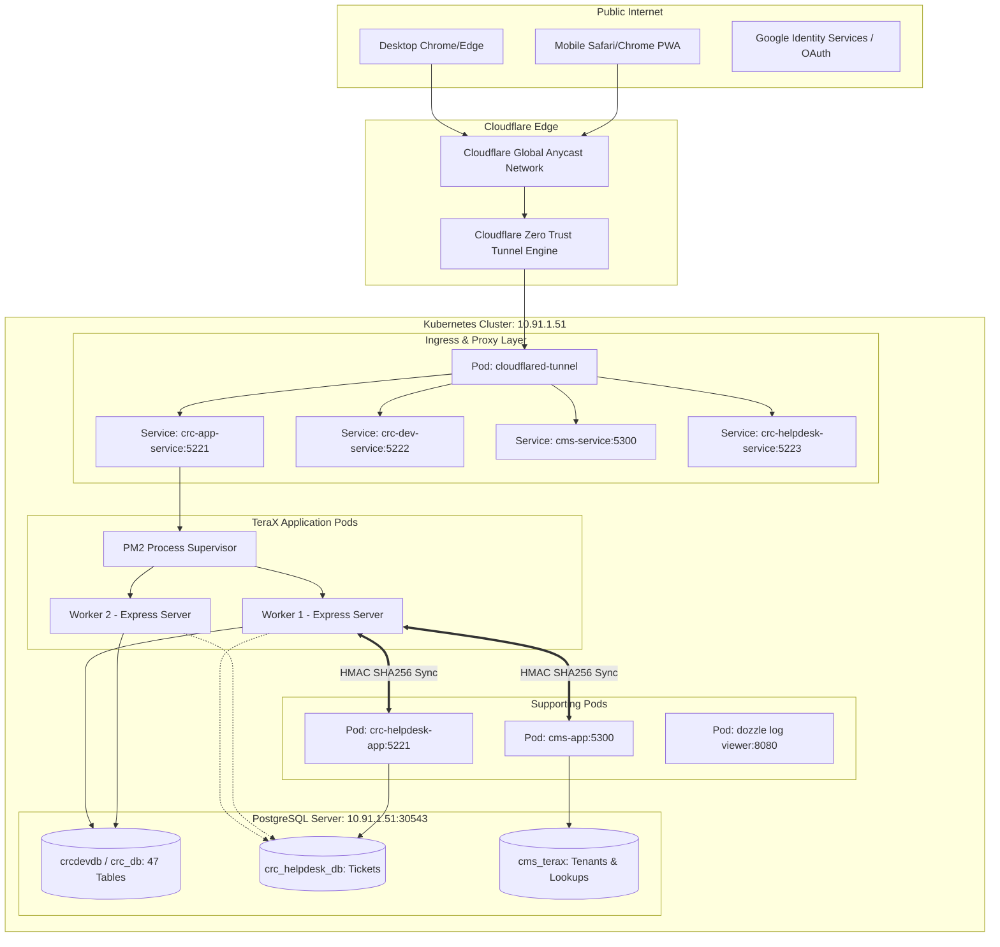

# 01 — SYSTEM ARCHITECTURE & TOPOLOGY AUDIT

> **Scope:** TeraX V2 Technical Stack, Runtime, Infrastructure, Protocols & Deployment  
> **Source Directory:** `D:\CPI\teraxV2`  
> **Target Migration Destination:** `D:\CPI\teraxV3`

---

## 1. Core Technical Stack Summary

| Dimension | TeraX V2 Current Implementation | Code Reference |
|---|---|---|
| **Runtime Environment** | Node.js v20 (Alpine Linux container image `node:20-alpine`) | [`Dockerfile:2`](file:///d:/CPI/teraxV2/Dockerfile#L2) |
| **Module System** | CommonJS (`require` / `module.exports`) | [`package.json:5`](file:///d:/CPI/teraxV2/package.json#L5) |
| **Package Manager** | `npm` (v10+) with `pnpm-workspace.yaml` mono-structure declared | [`package.json`](file:///d:/CPI/teraxV2/package.json), [`pnpm-workspace.yaml`](file:///d:/CPI/teraxV2/pnpm-workspace.yaml) |
| **Backend Framework** | Express.js 4.18.2 | [`package.json:15`](file:///d:/CPI/teraxV2/package.json#L15), [`server/index.js:2`](file:///d:/CPI/teraxV2/server/index.js#L2) |
| **Frontend Framework** | Vanilla HTML5 / ES6 Vanilla JS / Custom DOM Tab Router (No React/Vue/Angular) | [`public/index.html`](file:///d:/CPI/teraxV2/public/index.html), [`public/app.js`](file:///d:/CPI/teraxV2/public/app.js) |
| **CSS Framework** | Vanilla CSS (`public/style.css` - 191KB, ~7,255 lines) (No Tailwind / No Bootstrap) | [`public/style.css`](file:///d:/CPI/teraxV2/public/style.css) |
| **Typography & Icons** | Inter (Google Fonts) + Google Material Symbols Rounded & Outlined | [`public/index.html:18-20`](file:///d:/CPI/teraxV2/public/index.html#L18-L20) |
| **Database Engine** | PostgreSQL 15 / 16 (Relational + JSONB documents) | [`schema.dbml:5`](file:///d:/CPI/teraxV2/schema.dbml#L5), [`server/db.js:3`](file:///d:/CPI/teraxV2/server/db.js#L3) |
| **Database Client / ORM** | `pg` (node-postgres 8.11.3) with connection pool; no ORM | [`package.json:21`](file:///d:/CPI/teraxV2/package.json#L21), [`server/db.js:18`](file:///d:/CPI/teraxV2/server/db.js#L18) |
| **Database Migrations** | Embedded DDL runner on server boot (`initDb` in `server/db.js`) + raw SQL scripts | [`server/db.js:34-60`](file:///d:/CPI/teraxV2/server/db.js#L34-L60), [`migrations/`](file:///d:/CPI/teraxV2/migrations) |
| **Data Validation** | Zod 4.4.3 (Backend) + Custom validation logic in `server/helpers/validation.js` | [`package.json:26`](file:///d:/CPI/teraxV2/package.json#L26), [`server/helpers/validation.js`](file:///d:/CPI/teraxV2/server/helpers/validation.js) |
| **Authentication** | JWT (`jsonwebtoken` 9.0.3), `bcryptjs` 3.0.3, `google-auth-library` 10.6.2 | [`modules/identity/server/identity.service.js`](file:///d:/CPI/teraxV2/modules/identity/server/identity.service.js) |
| **Authorization / RBAC** | Dynamic Multi-dimension: `action_rules`, `exception_rules`, `column_permissions` | [`modules/identity/server/identity.controller.js`](file:///d:/CPI/teraxV2/modules/identity/server/identity.controller.js) |
| **File Storage** | Local Disk (`public/uploads`) + HTTP Sidecar fallback (`http://127.0.0.1:5005`) | [`server/index.js:167-300`](file:///d:/CPI/teraxV2/server/index.js#L167-L300), [`server/helpers/fileStorageHelper.js`](file:///d:/CPI/teraxV2/server/helpers/fileStorageHelper.js) |
| **Realtime Channel** | Server-Sent Events (SSE) via `/api/stream` (in-memory client set) | [`server/helpers/sseHelper.js`](file:///d:/CPI/teraxV2/server/helpers/sseHelper.js) |
| **Notification Engine** | In-app DB notification + Web Push (`web-push` 3.6.7) with VAPID keys | [`modules/notification/server/`](file:///d:/CPI/teraxV2/modules/notification/server/) |
| **Cron / Scheduling** | `node-cron` 4.2.1 (00:00 Outgoing payment rule, 01:00 Backup rotation) | [`server/cron.js`](file:///d:/CPI/teraxV2/server/cron.js), [`server/helpers/backupCron.js`](file:///d:/CPI/teraxV2/server/helpers/backupCron.js) |
| **Excel Export / Import** | `xlsx` (SheetJS 0.18.5 backend, 0.20.1 frontend CDN) | [`package.json:25`](file:///d:/CPI/teraxV2/package.json#L25), [`public/js/services/exportService.js`](file:///d:/CPI/teraxV2/public/js/services/exportService.js) |
| **Containerization** | Docker (Alpine + PM2 cluster runtime -i 2) | [`Dockerfile`](file:///d:/CPI/teraxV2/Dockerfile), [`docker-compose.yml`](file:///d:/CPI/teraxV2/docker-compose.yml) |
| **Orchestration** | Kubernetes 1.25+ manifests (`k8s-manifest.yaml`, `k8s-dev-cms.yaml`) | [`k8s-manifest.yaml`](file:///d:/CPI/teraxV2/k8s-manifest.yaml) |
| **Ingress & Networking** | Cloudflare Zero Trust Tunnel daemon (`cloudflared`) | [`k8s-manifest.yaml:138-160`](file:///d:/CPI/teraxV2/k8s-manifest.yaml#L138-L160) |

---

## 2. Infrastructure Architecture & Network Flow



---

## 3. Runtime & Process Management

- **Runtime Execution:**  
  Chạy bằng `pm2-runtime` với cờ cluster mode:
  ```bash
  pm2-runtime start server/index.js -i 2 --name crc-app
  ```
- **Lý do thiết kế 2 instances:** Khai thác 2 core CPU mà không vượt quá ngưỡng kết nối giới hạn của PostgreSQL (Pool max: 30 connections/instance $\times 2 = 60$ connections/pod).
- **Hệ quả kiến trúc:**
  - Hai worker processes hoạt động độc lập trên cùng một container.
  - Các biến toàn cục trong bộ nhớ RAM (`clients = new Set()` của SSE, `_facetedSummaryCache`, `_userReqIdsCache`) hoàn toàn bị phân mảnh giữa 2 worker.
  - Một sự kiện phát sinh ở Worker 1 phát SSE sẽ **không** đến được các client đang mở kết nối SSE tại Worker 2 nếu không có bus trung gian (Redis Pub/Sub).

---

## 4. Database Connection Pool Architecture

Cấu hình pool tập trung tại [`server/db.js:18-24`](file:///d:/CPI/teraxV2/server/db.js#L18-L24):
```javascript
const pool = new Pool({
  connectionString: process.env.DATABASE_URL,
  max: 30,                       // Tối đa 30 kết nối đồng thời từ 1 worker Node.js
  idleTimeoutMillis: 30000,      // Đóng kết nối nhàn rỗi sau 30 giây
  connectionTimeoutMillis: 10000,// Timeout nếu không kết nối được sau 10 giây
  ssl: needsSSL ? { rejectUnauthorized: false } : false
});
```

Hệ thống kết nối đến 3 database khác nhau tùy theo bảng:
1. **Main Tenant Database (`crcdevdb` / `crc_db`):** Chứa 44 bảng nghiệp vụ cốt lõi. Kết nối qua `DATABASE_URL`.
2. **Helpdesk Database (`crc_helpdesk_db`):** Chứa bảng `ticket`, `ticket_comment`, `ticket_type`. Khởi tạo qua pool động `_helpdeskPool` bằng cách bóc tách pathname của `DATABASE_URL` và thay thế bằng `/crc_helpdesk_db` ([`dynamic_crud.js:223-236`](file:///d:/CPI/teraxV2/server/routes/dynamic_crud.js#L223-L236)).
3. **CMS Database (`cms_terax`):** Chứa danh mục quốc gia, tiền tệ, tỉnh thành, thông tin gói đăng ký. Kết nối qua `_cmsPool` hoặc thông số cấu hình `CMS_LOOKUP_DB_*` ([`cmsLookups.js:6-15`](file:///d:/CPI/teraxV2/server/routes/cmsLookups.js#L6-L15)).

---

## 5. Storage Architecture & Quota Enforcement

- **Storage Target:** Thư mục đĩa vật lý [`public/uploads/`](file:///d:/CPI/teraxV2/public/uploads).
- **Cơ chế tải lên:**
  - `POST /api/upload-file`: Nhận JSON `{ name, base64 }`, giải mã Buffer và ghi file.
  - `POST /api/upload-binary`: Stream nhị phân trực tiếp (`req.pipe(writeStream)`) để giảm tải bộ nhớ RAM.
  - `POST /api/upload-chunk`: Hỗ trợ upload từng chunk nhỏ qua header query `chunkIndex`, `totalChunks` để vượt qua giới hạn payload 1MB của một số reverse proxy.
- **Ràng buộc an toàn & Giới hạn dung lượng:**
  - Danh sách đuôi tệp cấm ngặt nghèo: `exe`, `bat`, `cmd`, `sh`, `vbs`, `msi`, `dll`, `com`, `ps1`, `scr`, `bin`, `pif`, `jar` ([`server/index.js:146-154`](file:///d:/CPI/teraxV2/server/index.js#L146-L154)).
  - Hàm `checkStorageQuota()` kiểm tra dung lượng gói dịch vụ của tenant (`usedBytes + incomingBytes <= limitBytes`). Nếu vượt quá dung lượng gói thuê bao, lập tức ném lỗi 400.

---

## 6. Realtime Communication Protocol (SSE)

- **Giao thức:** Server-Sent Events (SSE) theo chuẩn W3C EventSource qua endpoint [`GET /api/stream?token=...`](file:///d:/CPI/teraxV2/server/index.js#L305-L314).
- **Xác thực:** Do API `EventSource` trong trình duyệt không hỗ trợ custom headers, token JWT được truyền qua Query Parameter: `?token=...`.
- **Keepalive Interval:** Cứ mỗi 25 giây gửi comment `: keepalive\n\n` để ngăn Cloudflare đóng kết nối HTTP do idle timeout (100s).
- **Payload Event:**
  ```text
  event: db_change
  data: {"action":"update","table":"payment","record":{...}}
  ```
- **Hạn chế V2 cần khắc phục trong V3:** Thiếu message broker (Redis / RabbitMQ). Khi scale ngang pod trên K8s, người dùng kết nối tới pod A sẽ không nhận được SSE phát ra từ pod B.

---

## 7. Kubernetes Deployment Structure

Theo manifest [`k8s-manifest.yaml`](file:///d:/CPI/teraxV2/k8s-manifest.yaml):
- **Namespace:** `default`
- **Deployment `crc-app-deployment`:**
  - Replicas: 1
  - Image: `crc-web-app:latest`
  - Container Port: 5221
  - Resource Limits: CPU 1000m, Memory 768Mi
  - Resource Requests: CPU 100m, Memory 256Mi
- **Service `crc-app-service`:** Type LoadBalancer, Port 5221 $\rightarrow$ TargetPort 5221.
- **Deployment `cloudflared-tunnel-deployment`:**
  - Container `cloudflare/cloudflared:latest` chạy tham số `tunnel run` kết nối bằng `TUNNEL_TOKEN`.
- **Log Management `dozzle-deployment`:**
  - Web UI xem log container trực tiếp qua port 8080 với ServiceAccount `pod-viewer`.

---

## 8. Migration Recommendations for V3

1. **Chuyển đổi Backend sang Type-Safe Monorepo:** Thay Express 4 CJS bằng NestJS / Fastify với TypeScript chặt chẽ, chia rõ Presentation, Application, Domain, Infrastructure (Clean Architecture).
2. **Thay thế Raw SQL bằng ORM hiện đại:** Sử dụng Drizzle ORM hoặc Prisma để có type-safe schema, auto-migration, loại bỏ 3,600 dòng DDL thủ công trong `server/db.js`.
3. **Thay thế Local Uploads bằng Object Storage:** Triển khai S3 client (AWS S3, MinIO, Cloudflare R2) với Pre-signed URL upload trực tiếp từ client lên storage, giảm 100% tải IO và CPU cho API Server.
4. **Phân tán SSE bằng Redis Pub/Sub:** Khi chuyển sang V3, bắt buộc có Redis adapter để SSE broadcast xuyên suốt tất cả instance và pods.
5. **Nâng cấp Quản trị Token:** Sử dụng Access Token ngắn hạn (15 phút) và Refresh Token lưu trữ trong Redis / DB có cơ chế xoay vòng (Token Rotation) và thu hồi ngay lập tức khi logout hoặc đổi mật khẩu.
