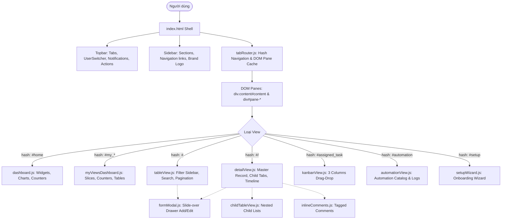

# 03 — FRONTEND APPLICATION AUDIT & PAGE MAP

> **Scope:** UI Shell, Layouts, Navigation, Routes, Component Tree, State Lifecycle & Mobile Behavior  
> **Source Directory:** `D:\CPI\teraxV2\public`  
> **Target Migration Destination:** `D:\CPI\teraxV3\apps\web`

---

## 1. Frontend Architecture Overview

Ứng dụng Frontend của TeraX V2 là một ứng dụng **Single Page Application (SPA)** viết bằng **Vanilla JavaScript (ES6)**, nạp thẳng file tĩnh HTML/JS/CSS từ máy chủ Express mà không qua quá trình build/bundle (không dùng Webpack/Vite/Rollup).

### Các Trụ Cột Kiến Trúc Frontend:



---

## 2. Shell Layouts & Components

### 2.1 Sidebar (`aside.sidebar`)
- **Vị trí code:** [`public/index.html:47-248`](file:///d:/CPI/teraxV2/public/index.html#L47-L248)
- **Hành vi:**
  - Có 2 trạng thái: `expanded` (rộng 260px) và `collapsed` (thu gọn 68px). Bấm vào logo để toggle.
  - Trên màn hình nhỏ ($\le 768\text{px}$): Mở dạng Drawer trượt từ mép trái, kèm backdrop làm mờ màn hình (`.sidebar-backdrop`).
  - Gồm 5 nhóm menu chính:
    1. **Workspace:** Dashboard (`#home`), My Requests (`#my_request`), My Approvals (`#my_approval`), My Task (`#my_process_owner`), My Process (`#my_team`).
    2. **Organization:** My Company (`#my_company`), Employees (`#employee`), Customer/Supplier (`#company`), Opportunities (`#oppotunity`).
    3. **Finance:** Payments (`#payment`), Expenses (`#expense`), Invoices (`#invoice`), Contracts (`#contract`), Accounts (`#account`), Finance (`#finance`).
    4. **Administration:** Services (`#service`), Assets (`#asset`), Process (`#policy`).
    5. **Other & Settings:** Reports (`#request_activity_log`), Support (`#support`), Settings dropdown (Action Rules, Automation, Column Permissions, Menu Rules, Subscription, Setup Wizard).
  - Footer chứa: Language Selector (`i18n`), Nút Đổi mật khẩu (`openChangePasswordModal`), Nút Đăng xuất (`logout`), Version Tag (`v2.0.0`).

### 2.2 Topbar (`div.topbar`)
- **Vị trí code:** [`public/index.html:254-318`](file:///d:/CPI/teraxV2/public/index.html#L254-L318)
- **Thành phần:**
  - Hamburger menu icon (chỉ hiện trên Mobile).
  - Khay chứa tab đa nhiệm (`#topbar-tabs-container`): Hiển thị danh sách các view đang mở, nút đóng tab (`closeTabPane`), context menu chuột phải (đóng tab khác, đóng bên phải, đóng tab chi tiết).
  - User Switcher dropdown (`#topbar-user-switcher`): Cho phép chuyển nhanh nhân viên để test quyền (chỉ hiện ở desktop).
  - Custom Actions container (`#topbar-actions-custom`): Chứa các nút Add Record, Export Excel, Filter toggle.
  - Notification icon & dropdown (`#notificationDropdown`): Danh sách thông báo realtime kèm phân trang.

### 2.3 Status Cards Bar (`#global-status-cards-container`)
- Hiển thị thanh tóm tắt số lượng bản ghi theo từng trạng thái (ví dụ: Draft: 5, Pending: 12, Approved: 84).

### 2.4 Modals & Drawers
Toàn bộ Modal được viết sẵn trong [`public/index.html`](file:///d:/CPI/teraxV2/public/index.html) và bật tắt qua class `.active` của `.modal-overlay`:
1. `#form-modal` (`.modal.slide-over`): Drawer trượt từ cạnh phải màn hình dùng cho Form Thêm mới / Sửa bản ghi.
2. `#confirm-modal` (`.modal.confirm-dialog`): Hộp thoại xác nhận xóa bản ghi.
3. `#alert-modal`: Hộp thoại thông báo hoàn thành action.
4. `#discard-modal`: Cảnh báo mất dữ liệu khi người dùng bấm đóng form đang nhập dở.
5. `#action-prompt-modal`: Nhập tham số đầu vào cho action (ví dụ: lý do từ chối, chọn người nhận việc).
6. `#action-confirm-modal`: Hộp thoại xác nhận trước khi thực thi action nghiệp vụ quan trọng.
7. `#change-password-modal`: Modal đổi mật khẩu đăng nhập.
8. `#toast-container`: Khay hiển thị popup thông báo góc phải màn hình.

---

## 3. Comprehensive Page & Route Inventory

### Page 1: Dashboard Home
```text
Route: #home
Page name: Dashboard Overview
Purpose: Trang đích mặc định sau khi đăng nhập, hiển thị tổng quan chỉ số, biểu đồ công việc và danh sách việc cần xử lý.
Main components: Stats Cards (My Requests, Approvals, Tasks), Charts Widget (Bar/Donut chart), Recent Activity Feed.
API used: GET /api/my-views/stats/summary, GET /api/my-views/my-request?limit=5, GET /api/my-views/my-approval?limit=5
Main tables/entities: request, audit_logs
Actions: Chuyển nhanh sang các tab quy trình, xem nhanh chi tiết bản ghi.
Permissions: Yêu cầu đăng nhập, mọi role đều truy cập được.
Workflow actions: N/A
Reusable UI: Stat cards, quick table summary, chart wrapper.
Responsive behavior: Chuyển từ grid 3-4 cột sang 1 cột duy nhất trên mobile.
```

---

### Page 2: My Requests (Yêu Cầu Của Tôi)
```text
Route: #my_request (hoặc #my_request/<id>)
Page name: My Requests Workspace
Purpose: Hiển thị toàn bộ các yêu cầu (SR) do chính người dùng tạo hoặc là người thụ hưởng (Requester), hoặc được gắn tag trong bình luận.
Main components: Metric Counter Cards (Draft, Pending Approval, Approved, Processing, Completed, Cancelled), Filter Bar, Data Table, Action Buttons.
API used: GET /api/my-views/my-request, GET /api/table/request/:id, POST /api/actions/execute
Main tables/entities: request, employee, my_company, policy_and_program, comment
Actions: Tạo mới yêu cầu (mở form wizard/modal), Submit yêu cầu, Rút yêu cầu (Withdraw), Đánh giá hoàn thành (Rate).
Permissions: Kiểm tra qua /api/permissions/my-slices ('my_request').
Workflow actions: ACT-REQUEST-09 (Submit), withdraw_request (Rút), ACT-REQUEST-03 (Rate & Close).
Reusable UI: Table View component, Status Badge component, Search input.
Responsive behavior: Ẩn bớt các cột phụ, chuyển bảng sang chế độ cuộn ngang, hỗ trợ card view trên màn hình hẹp.
```

---

### Page 3: My Approvals (Cần Tôi Phê Duyệt)
```text
Route: #my_approval (hoặc #my_approval/<id>)
Page name: My Approvals Workspace
Purpose: Lát cắt hiển thị danh sách các yêu cầu đang chờ chính người dùng hiện tại phê duyệt ở cấp tương ứng trong approval_flow (hoặc lịch sử đã duyệt).
Main components: Status Metric Cards, Approval Table, Multi-select Approval, Bulk Action Bar.
API used: GET /api/my-views/my-approval, POST /api/actions/execute
Main tables/entities: request, employee, policy_and_program
Actions: Phê duyệt (Approve), Từ chối kèm lý do (Reject), Duyệt hàng loạt (Bulk Approve).
Permissions: Kiểm tra exception_rules ('my_approval').
Workflow actions: approve_request, reject_request.
Reusable UI: Action Button, Prompt Input Dialog, Status Pills.
Responsive behavior: Nút hành động phê duyệt/từ chối được ghim nổi (sticky) trên mobile để người dùng thao tác một chạm.
```

---

### Page 4: My Tasks / Process Owner (Nhiệm Vụ Xử Lý)
```text
Route: #my_process_owner (hoặc alias #my_task)
Page name: My Task Workspace
Purpose: Dành cho đội ngũ kỹ thuật/vận hành (sr_owner). Hiển thị các yêu cầu đã được duyệt và cần thực thi/triển khai.
Main components: Process Metric Cards (Not started yet, Processing, Completed), Table, Task Status Updater.
API used: GET /api/my-views/my-process-owner, POST /api/actions/execute
Main tables/entities: request, employee, assigned_task
Actions: Bắt đầu xử lý (Start), Cập nhật trạng thái xử lý, Bàn giao nhiệm vụ, Hoàn tất yêu cầu.
Permissions: Kiểm tra exception_rules ('my_process_owner').
Workflow actions: ACT-REQUEST-08 (Start - tự động sinh assigned_task), ACT-REQUEST-04 (Cập nhật process_status), ACT-REQUEST-07 (Complete).
Reusable UI: Progress Badge, Dropdown Filter, Assigned Task sub-table.
Responsive behavior: Cuộn bảng ngang có sticky cột mã yêu cầu.
```

---

### Page 5: My Process / My Team (Quản Lý Quy Trình Phòng Ban)
```text
Route: #my_team
Page name: My Team Process Overview
Purpose: Dành cho Trưởng quy trình (policy_lead). Giám sát tiến độ toàn bộ các yêu cầu thuộc phạm vi chính sách của phòng ban mình.
Main components: Metric Counters, SLA Warning Indicators, Table, Team Assignment.
API used: GET /api/my-views/my-team, POST /api/actions/execute
Main tables/entities: request, employee, policy_and_program
Actions: Đổi SR Owner, Can thiệp tiến độ xử lý, Hủy yêu cầu.
Permissions: Kiểm tra exception_rules ('my_team').
Workflow actions: ACT-REQUEST-01 (Change SR Owner), ACT-REQUEST-05 (Cancel), ACT-REQUEST-04 (Re-update Process Status).
Reusable UI: User selector dropdown, SLA warning badge.
Responsive behavior: Ẩn cột ngày chi tiết, giữ lại SLA và Trạng thái.
```

---

### Page 6: Request Master List (Quản Lý Tất Cả Yêu Cầu - Admin)
```text
Route: #request (hoặc #request/<id>)
Page name: Request Master Management
Purpose: Trang danh trị tổng thể dành cho Admin/HR/Quản trị viên để xem toàn bộ yêu cầu trong hệ thống.
Main components: Search Bar, Advanced Filter Sidebar, Data Table, Export Excel, Batch Delete.
API used: GET /api/table/request, POST /api/table/request, PUT /api/table/request/:id, DELETE /api/table/request/:id
Main tables/entities: request, policy_and_program, employee
Actions: Thêm mới, Sửa, Xóa, Phục hồi bản ghi đã xóa, Xuất file Excel.
Permissions: Kiểm tra column_permissions và action_rules ('add_request', 'edit_request', 'delete_request').
Workflow actions: Mọi action quy trình trong chi tiết.
Reusable UI: Slide-over Drawer Form, Advanced Filter Drawer, Excel Export Button.
Responsive behavior: Khung Filter bên trái tự động ẩn thành Popup Drawer trên màn hình < 900px.
```

---

### Page 7: Request Detail View (Màn Hình Chi Tiết Yêu Cầu)
```text
Route: #request/:id (hoặc #my_request/:id, #my_approval/:id)
Page name: Request Detail View
Purpose: Màn hình trung tâm hiển thị toàn bộ hồ sơ yêu cầu, quy trình phê duyệt trực quan, các tài liệu con và bình luận.
Main components:
  1. Header: Mã SR, Trạng thái (sr_status, process_status), Nút Action động theo quyền.
  2. Master Fields: Mô tả, Requester, Creator, Cấp duyệt, Ngày tạo.
  3. Approval Flow Stepper: Thanh hiển thị trực quan các tầng duyệt (Tier 1 -> Tier 3) với avatar người duyệt và thời điểm.
  4. Child Tabs Header: Danh sách các tab con liên kết:
     - Payments (Phiếu thanh toán liên đới)
     - Invoices (Hóa đơn)
     - Contracts (Hợp đồng)
     - Assets (Tài sản)
     - Services (Dịch vụ)
     - Tasks (Công việc được giao)
     - Logs (Lịch sử audit log)
  5. Inline Comments & Activity Stream: Khung chat thảo luận nội bộ gắn tag @mention và đính kèm tệp.
API used:
  - GET /api/table/request/:id?pk=request_id
  - GET /api/actions/request/:id
  - GET /api/actions/request/:id/participants
  - GET /api/table/:childTable?request=:id
  - POST /api/actions/execute
  - POST /api/table/comment
Main tables/entities: request, employee, payment, invoice, contract, asset, service, assigned_task, comment, audit_logs
Actions: Execute Action (Approve/Reject/Start/Cancel/Rate), Thêm bản ghi con (Add Payment, Add Task), Gửi bình luận.
Permissions: RLS kiểm tra user có liên quan đến request không (Requester, Creator, Policy Lead, SR Owner, Approver, Tagged).
Workflow actions: Tất cả các action được định nghĩa trong server/routes/actions.js.
Reusable UI: Stepper timeline, Tab header bar, Nested child table view, Comment composer.
Responsive behavior: Các tab con chuyển thành thanh cuộn ngang; khung comment chuyển xuống dưới cùng của trang.
```

---

### Page 8: Payment Management (Quản Lý Thanh Toán)
```text
Route: #payment (hoặc #payment/<id>)
Page name: Payment List & Detail
Purpose: Quản lý các khoản thanh toán Incoming (thu) và Outgoing (chi).
Main components:
  - Summary Cards: Tổng chi, Tổng thu, Chờ thanh toán, Đã thanh toán.
  - Table: Loại phiếu, Số tiền, Loại tiền, Tỷ giá, Trạng thái, Đối tác, MTR Transaction.
  - Detail View: Thông tin phiếu, Hợp đồng cha, Request liên kết, Tab Hóa đơn con, Tab Lịch sử đối soát.
API used:
  - GET /api/table/payment
  - POST /api/table/payment
  - PUT /api/table/payment/:id
  - POST /api/actions/execute
  - GET /api/actions/payment/:paymentId/mtrs
Main tables/entities: payment, contract, request, mtr, account, invoice
Actions:
  - Tạo phiếu thanh toán mới.
  - Action 'payment_req_outgoing': Trình ký yêu cầu thanh toán (tự động tạo một Request loại RPM).
  - Action 'payment_ready': Chuyển trạng thái sẵn sàng chi tiền.
  - Action 'payment_paid': Xác nhận đã thanh toán (chọn giao dịch sao kê MTR, tự động sinh Invoice nếu hợp đồng Selling).
  - Action 'payment_change_mtr': Đổi giao dịch ngân hàng đã gắn.
Permissions: Phân quyền theo exception_rules ('payment') và action_rules.
Workflow actions: payment_req_outgoing, payment_ready, payment_paid, payment_change_mtr.
Reusable UI: Currency formatter, Exchange rate calculator, MTR lookup dropdown.
Responsive behavior: Bảng cuộn ngang, format số tiền to rõ trên mobile.
```

---

### Page 9: Invoice Management (Quản Lý Hóa Đơn)
```text
Route: #invoice (hoặc #invoice/<id>)
Page name: Invoice List & Detail
Purpose: Quản lý hóa đơn VAT đầu vào và đầu ra của doanh nghiệp.
Main components: Table danh sách hóa đơn, Form phát hành hóa đơn, Báo cáo thuế GTGT.
API used: GET /api/table/invoice, POST /api/table/invoice, PUT /api/table/invoice/:id
Main tables/entities: invoice, contract, payment, request, my_company, company
Actions: Tạo mới hóa đơn, Phát hành hóa đơn, Hủy hóa đơn (Void), Đánh dấu đã thanh toán.
Permissions: Kiểm tra exception_rules ('invoice').
Workflow actions: Thay đổi trạng thái: Draft -> Ready to issue -> Issued -> Paid -> Void.
Reusable UI: Tax calculation input, Counterparty lookup.
Responsive behavior: Form nhập chia 2 cột trên desktop, 1 cột trên mobile.
```

---

### Page 10: Contract Management (Quản Lý Hợp Đồng)
```text
Route: #contract (hoặc #contract/<id>)
Page name: Contract List & Detail
Purpose: Quản lý hồ sơ hợp đồng mua, bán và nội bộ.
Main components: Table danh sách hợp đồng, Detail view hiển thị tiến độ thanh toán và hóa đơn đi kèm.
API used: GET /api/table/contract, POST /api/table/contract, PUT /api/table/contract/:id
Main tables/entities: contract, company, department, request, payment, invoice
Actions: Tạo hợp đồng, Đính kèm file PDF scan, Theo dõi giá trị nghiệm thu.
Permissions: Kiểm tra exception_rules ('contract').
Workflow actions: N/A (Status field driven).
Reusable UI: PDF Attachment viewer, Contract timeline.
Responsive behavior: Hỗ trợ xem file PDF trực tiếp trên trình duyệt.
```

---

### Page 11: Expense Management (Quản Lý Chi Phí)
```text
Route: #expense (hoặc #expense/<id>)
Page name: Expense List
Purpose: Bóc tách chi phí doanh nghiệp phục vụ báo cáo quản trị P&L.
Main components: Table chi phí phân loại theo Operation/Sales/Fixed/Variable cost.
API used: GET /api/table/expense, POST /api/table/expense, PUT /api/table/expense/:id
Main tables/entities: expense, request, payment, department
Actions: Tạo chi phí, Gắn trung tâm chi phí (Cost Center).
Permissions: Kiểm tra exception_rules ('expense').
Workflow actions: N/A
Reusable UI: Expense Category Dropdown, Fiscal Year Selector.
Responsive behavior: Cuộn bảng ngang.
```

---

### Page 12: Account & MTR Management (Tài Khoản & Sao Kê Ngân Hàng)
```text
Route: #account, #finance
Page name: Account & Bank Transactions (MTR)
Purpose: Quản lý danh sách tài khoản ngân hàng của doanh nghiệp và sao kê biến động số dư (Money Transfer Record - MTR).
Main components: Account cards, MTR transaction grid, Finance summary dashboard.
API used: GET /api/table/account, GET /api/table/mtr, GET /api/table/finance/request-summary/:requestId
Main tables/entities: account, mtr, my_company
Actions: Thêm tài khoản ngân hàng, Nhập sao kê ngân hàng (Import Excel MTR), Phân quyền người kiểm soát tài chính (`finance_control`).
Permissions: Kiểm tra quyền quản lý tài khoản ngân hàng.
Workflow actions: Gắn MTR vào phiếu thanh toán đã chi.
Reusable UI: Bank account badge, Transaction status pill.
Responsive behavior: Chuyển dạng card trên điện thoại.
```

---

### Page 13: Organization & Employees (Nhân Sự & Tổ Chức)
```text
Route: #my_company, #department, #employee, #company, #contact
Page name: Organization Structure
Purpose: Quản lý dữ liệu gốc (Master Data) của doanh nghiệp: Pháp nhân công ty, phòng ban, hồ sơ nhân viên, chức danh, quản lý trực tiếp, khách hàng, nhà cung cấp.
Main components: Danh sách phòng ban dạng cây, Danh sách nhân viên, Form cấp quyền tài khoản, Form gán Quản lý trực tiếp (`direct_manager`).
API used: GET/POST/PUT/DELETE trên các route `/api/my-company`, `/api/departments`, `/api/employees`, `/api/companies`, `/api/contacts`.
Main tables/entities: my_company, department, employee, company, contact, my_location
Actions: Thêm nhân viên mới, Reset mật khẩu, Khóa tài khoản, Bổ nhiệm quản lý phòng ban.
Permissions: Admin / HR / Super Admin.
Workflow actions: N/A
Reusable UI: Avatar uploader, Role dropdown, Direct manager selector.
Responsive behavior: Bảng danh bạ thu gọn có nút gọi điện/gửi email nhanh trên mobile.
```

---

### Page 14: Asset Management (Quản Lý Tài Sản)
```text
Route: #asset (hoặc #asset/<id>)
Page name: Asset Management
Purpose: Quản lý trang thiết bị văn phòng, máy tính, tài sản cố định.
Main components: Table danh sách tài sản, Form bàn giao tài sản cho nhân viên, Vị trí tài sản.
API used: GET /api/table/asset, POST /api/table/asset, PUT /api/table/asset/:id
Main tables/entities: asset, employee, my_location, request
Actions: Thêm tài sản, Bàn giao người sử dụng hiện tại (`current_owner`), Cập nhật hiện trạng hỏng hóc/bảo hành.
Permissions: Kiểm tra exception_rules ('asset').
Workflow actions: N/A (Status catalog driven).
Reusable UI: Asset barcode/code generator, Location select.
Responsive behavior: Cuộn ngang.
```

---

### Page 15: Service Management (Quản Lý Dịch Vụ Định Kỳ)
```text
Route: #service (hoặc #service/<id>)
Page name: Service & Subscription Management
Purpose: Quản lý các dịch vụ trả phí định kỳ (SaaS, thuê văn phòng, bảo trì server), cảnh báo ngày hết hạn để gia hạn.
Main components: Table dịch vụ, Bộ đếm dịch vụ sắp hết hạn (Going to expire), Form thiết lập chu kỳ gia hạn.
API used: GET /api/table/service, POST /api/table/service, PUT /api/table/service/:id
Main tables/entities: service, request, contract, company
Actions: Tạo dịch vụ, Kích hoạt gia hạn, Đóng dịch vụ.
Permissions: Kiểm tra exception_rules ('service').
Workflow actions: Chuyển đổi trạng thái từ Active -> Going to expired -> Expired.
Reusable UI: Expiration countdown badge.
Responsive behavior: Bảng cuộn ngang.
```

---

### Page 16: Assigned Task & Kanban (Quản Lý Công Việc)
```text
Route: #assigned_task (hoặc #assigned_task/<id>)
Page name: Task Kanban & List View
Purpose: Quản lý các công việc được giao từ quy trình Request hoặc giao trực tiếp.
Main components: Bảng Kanban 3 cột: Not started yet, Processing, Completed. Thẻ công việc có deadline, file hướng dẫn, người nhận việc.
API used: GET /api/table/assigned_task, PUT /api/table/assigned_task/:id, GET /api/table/task_subtask
Main tables/entities: assigned_task, task_subtask, request, employee
Actions: Kéo thả thẻ đổi trạng thái công việc, Báo cáo tiến độ hoàn thành, Đính kèm file kết quả.
Permissions: Kiểm tra quyền xem task cá nhân hoặc task được giao.
Workflow actions: Cập nhật status task từ 62 (Not started) -> 63 (In progress) -> 64 (Completed).
Reusable UI: Kanban board drag-drop column, Task card.
Responsive behavior: Chuyển sang dạng tab chuyển đổi giữa 3 cột trên mobile.
```

---

### Page 17: Support & Helpdesk (Hỗ Trợ Khách Hàng)
```text
Route: #support (hoặc #support/<id>)
Page name: Support Ticket Management
Purpose: Tiếp nhận và xử lý sự cố kỹ thuật từ khách hàng/người dùng nội bộ.
Main components: Danh sách ticket hỗ trợ, Chi tiết sự cố, Trao đổi bình luận với Helpdesk trung tâm.
API used: GET /api/table/ticket, POST /api/table/ticket, POST /api/actions/execute, POST /api/support/sync-incoming
Main tables/entities: ticket, ticket_comment, ticket_type
Actions: Gửi ticket mới, Rút ticket, Đánh giá sao độ hài lòng (`ACT-TICKET-03`).
Permissions: Mọi user đăng nhập.
Workflow actions: ACT-TICKET-03 (Rate), ACT-TICKET-05 (Cancel), withdraw_ticket.
Reusable UI: Rating stars dialog, Ticket comment box.
Responsive behavior: Tối ưu khung trao đổi chat trên điện thoại.
```

---

### Page 18: System Setup Wizard (Onboarding Khởi Tạo Hệ Thống)
```text
Route: #setup
Page name: System Setup Wizard
Purpose: Wizard hướng dẫn quản trị viên thiết lập hệ thống lần đầu (thông tin công ty, tiền tệ mặc định, phòng ban, tài khoản admin).
Main components: 4 bước Wizard dạng stepper, form nhập liệu có auto-fetch quốc gia/tiền tệ từ CMS.
API used: GET /api/system-setup/status, GET /api/system-setup/lookups/countries, POST /api/system-setup/save
Main tables/entities: system_setup, my_company, employee, department
Actions: Lưu từng bước khởi tạo, Hoàn tất thiết lập.
Permissions: Chỉ kích hoạt khi `window.setupCompleted === false` hoặc truy cập bằng quyền Super Admin.
Workflow actions: Chuyển trạng thái setup_completed sang true.
Reusable UI: Setup step navigation, Searchable dropdown quốc gia.
Responsive behavior: Các bước hiển thị dọc trên mobile.
```

---

### Page 19: Action Rules & Permissions Settings (Cấu Hình Phân Quyền)
```text
Route: #action_rules, #permissions, #exception_rules, #automation
Page name: Security & Workflow Configuration
Purpose: Quản lý bảng phân quyền menu, phân quyền cột dữ liệu nhạy cảm, cấu hình nút bấm hành động và danh mục tự động hóa.
Main components:
  - Table Action Rules (Danh sách action, biểu thức role, levels, positions, exceptions).
  - Column Permissions Grid (Bảng chọn ma trận quyền theo cột).
  - Automation Control List (Danh sách trigger và công tắc bật/tắt).
API used:
  - GET/POST/PUT/DELETE /api/permissions/column-permissions
  - GET/POST/PUT/DELETE /api/table/action_rules
  - GET /api/automations, PUT /api/automations/:id/active
Main tables/entities: action_rules, column_permissions, exception_rules, automation_registry, automation_run_logs
Actions: Thêm/Sửa rule phân quyền, Bật/Tắt trigger tự động hóa.
Permissions: Super Admin duy nhất.
Workflow actions: N/A
Reusable UI: Matrix checkbox selector, Toggle switch.
Responsive behavior: Khuyến cáo sử dụng trên màn hình máy tính desktop.
```

---

## 4. UI State Lifecycles

1. **Loading State:**
   - Hệ thống không dùng spinner xoay tròn đơn điệu mà dùng **Skeleton Screen** mô phỏng chính xác khung bảng và thanh tìm kiếm ([`public/index.html:323-397`](file:///d:/CPI/teraxV2/public/index.html#L323-L397)).
2. **Empty State:**
   - Khi bảng không có dữ liệu, hiển thị icon hộp rỗng kèm thông báo đa ngôn ngữ: `data-i18n="table.empty"` ("Không có dữ liệu").
3. **Error State:**
   - Lỗi API được bắt và hiển thị popup Toast đỏ góc trên màn hình (`showToast(msg, 'error')`), không làm vỡ giao diện hay trắng màn hình.
4. **No-Flashing Cache Lifecycle:**
   - Sau khi gọi API mutate (`POST /api/actions/execute`), dữ liệu mới được merge trực tiếp vào mảng `currentData` tại vị trí index tương ứng, giao diện chỉ re-render phần tử DOM bị thay đổi thay vì tải lại toàn bộ danh sách.
