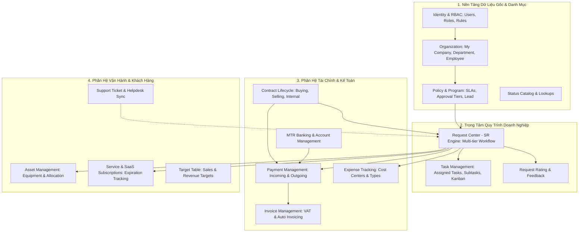

# 06 — BUSINESS MODULE MAP & DOMAIN BOUNDARIES

> **Scope:** Grounded Mapping of All Actual Business Domains, State Machines, Data Entities & Rules  
> **Source Directory:** `D:\CPI\teraxV2`  
> **Target Migration Destination:** `D:\CPI\teraxV3`

---

## 1. Domain Dependency & Integration Map

Dưới đây là sơ đồ phụ thuộc nghiệp vụ thực tế giữa các phân hệ:

---

## 2. Chi Tiết Từng Business Module

---

### Module 1: Identity & Access Management (IAM)
- **Purpose:** Quản lý vòng đời tài khoản người dùng, xác thực đăng nhập bảo mật (mật khẩu/Google SSO), cấp phát token JWT và thực thi phân quyền 4 chiều (Menu, Cột dữ liệu, Hành động).
- **Main tables:** `employee`, `column_permissions`, `permission_levels`, `permission_positions`, `permission_roles`, `permission_exceptions`, `exception_rules`, `action_rules`.
- **Main APIs:**
  - `POST /api/auth/login`, `POST /api/auth/google-login`, `GET /api/auth/me`, `POST /api/auth/change-password`
  - `GET /api/permissions/my-slices`, `GET /api/permissions/my-columns`, `GET /api/permissions/my-action-permissions`
  - `GET/POST/PUT/DELETE /api/permissions/column-permissions`
- **Frontend pages:** `#login.html`, `#permissions`, `#exception_rules`, `#action_rules`.
- **Permissions:** Super Admin quản trị toàn bộ rule; mọi người dùng đều có token xác thực riêng.
- **Workflow/statuses:** Trạng thái tài khoản nhân viên: `Active (17)` hoặc `Inactive (18)`. Cờ `app_user_enabled` (boolean).
- **Dependencies:** Độc lập, là nền tảng khởi đầu cho mọi module khác.
- **Important business rules:**
  - `SUPER ADMIN` tự động bypass 100% kiểm tra phân quyền (luôn có quyền thực hiện mọi action và xem mọi cột).
  - Quyền truy cập cột được so khớp theo 4 chiều: Exception list $\rightarrow$ Role $\rightarrow$ Employee Level $\rightarrow$ Position.
  - Token JWT hiện có hạn 365 ngày không xoay vòng.

---

### Module 2: Organization & Master Data
- **Purpose:** Quản lý thông tin pháp nhân công ty (`my_company`), cơ cấu tổ chức phòng ban (`department`), hồ sơ nhân sự và phân cấp quản lý (`employee`), địa điểm văn phòng (`my_location`), danh bạ đối tác khách hàng/nhà cung cấp (`company`), và người liên hệ (`contact`).
- **Main tables:** `my_company`, `department`, `employee`, `my_location`, `company`, `contact`.
- **Main APIs:**
  - `GET/POST/PUT/DELETE /api/my-company`
  - `GET/POST/PUT/DELETE /api/departments`
  - `GET/POST/PUT/DELETE /api/employees`
  - `GET/POST/PUT/DELETE /api/companies`
  - `GET/POST/PUT/DELETE /api/contacts`
- **Frontend pages:** `#my_company`, `#department`, `#employee`, `#company`, `#contact`.
- **Permissions:** Admin / HR / Super Admin.
- **Workflow/statuses:** Trạng thái nhân viên: `17` (Active), `18` (Inactive). Pháp nhân: `67` (Active), `68` (Inactive).
- **Dependencies:** Identity (để tạo tài khoản đăng nhập cho nhân viên).
- **Important business rules:**
  - Cột `direct_manager` trong bảng `employee` đóng vai trò tối quan trọng: dùng để tự động phân giải người phê duyệt Tier 1 cho các quy trình duyệt của nhân viên cấp dưới.
  - Phân cấp quản trị: `head_manager` quản lý cấp cao, `direct_manager` quản lý trực tiếp.
  - Bảng `my_company` quyết định thương hiệu và logo động hiển thị trên giao diện của từng tenant.

---

### Module 3: Request Management (Company Request Center - SR Engine)
- **Purpose:** Phân hệ trung tâm quan trọng nhất của TeraX V2. Tiếp nhận mọi yêu cầu dịch vụ nội bộ (yêu cầu chi tiền, mua sắm tài sản, nghỉ phép, hợp đồng, dịch vụ), vận hành quy trình phê duyệt đa cấp (Tier 0 đến Tier 3), giám sát SLA, ghi nhận đánh giá chất lượng và lưu trữ thảo luận có gắn tag người liên quan.
- **Main tables:** `request`, `comment`, `request_rating`, `request_watches`, `audit_logs`.
- **Main APIs:**
  - `GET/POST/PUT/DELETE /api/table/request`
  - `GET /api/table/request/:id`, `GET /api/actions/request/:id`
  - `POST /api/actions/execute`
  - `GET /api/my-views/:viewType` (my-request, my-approval, my-process-owner, my-team)
  - `POST /api/table/comment`
- **Frontend pages:** `#my_request`, `#my_approval`, `#my_process_owner`, `#my_team`, `#request`, `#request/:id`.
- **Permissions:** Phân quyền theo vai trò trong từng yêu cầu: Requester, Creator, Tier Approver, SR Owner, Policy Lead, hoặc Tagged in comment.
- **Workflow/statuses:**
  - `sr_status`: Draft (1) $\rightarrow$ Pending Approval (2) $\rightarrow$ Approved (3) $\rightarrow$ Closed (5). Nhánh hủy: Rejected (4), Cancelled (6).
  - `process_status`: Not started yet (7) $\rightarrow$ Processing (8) $\rightarrow$ Completed (9) / Canceled (117).
- **Dependencies:** Organization (Requester, Approver, Owner), Policy & Program (Quy định cấp duyệt và SLA).
- **Important business rules:**
  - Tự động sinh mã tuần tự dạng: `<RequestType>-<DDMMYY>-<Initials>-<Seq>` (ví dụ: `5-051026-TL-1`).
  - Khi `sr_status = 2` (Submit), DB trigger `trg_request_submit_status` tự động đặt `sr_submitted_date = CURRENT_TIMESTAMP` và bật bước duyệt 1 sang Pending.
  - Duyệt tuần tự: Chỉ khi người duyệt cấp $N$ chấp thuận thì cấp $N+1$ mới chuyển sang Pending.
  - Nếu cùng 1 người duyệt nhiều cấp liên tiếp, thuật toán trong `actions.js` tự động cascade duyệt qua các cấp đó trong 1 lần bấm.
  - Đánh giá sao (`ACT-REQUEST-03`): Nếu đánh giá $\le 3$ sao bắt buộc phải nhập lý do giải trình. Đánh giá thành công tự động đóng yêu cầu (`sr_status = 5`, `process_status = 9`).

---

### Module 4: Payment & Finance Operations
- **Purpose:** Lập kế hoạch dòng tiền, quản lý các khoản thanh toán công nợ nhà cung cấp (Outgoing) hoặc nhận tiền khách hàng (Incoming), tích hợp đối soát sao kê ngân hàng (MTR) và tự động sinh yêu cầu duyệt chi.
- **Main tables:** `payment`, `mtr`, `account`, `finance`, `request`, `contract`, `invoice`.
- **Main APIs:**
  - `GET/POST/PUT/DELETE /api/table/payment`
  - `POST /api/actions/execute` (`payment_req_outgoing`, `payment_ready`, `payment_paid`, `payment_change_mtr`)
  - `GET /api/actions/payment/:paymentId/mtrs`
  - `GET /api/table/account`, `GET /api/table/mtr`
- **Frontend pages:** `#payment`, `#payment/:id`, `#account`, `#finance`.
- **Permissions:** Kế toán thanh toán, Kiểm soát tài chính (`finance_control`), Người quản lý giao dịch (`transaction_managed_by`).
- **Workflow/statuses:**
  - `payment_status`: Draft (30) $\rightarrow$ Ready for payment (31) $\rightarrow$ Paid (32) $\rightarrow$ Deleted (33) / Submitted for payment (121).
  - `payment_type`: Incoming (60), Outgoing (61).
- **Dependencies:** Request (để trình duyệt chi), Contract (để liên kết điều khoản thanh toán), MTR & Account (để đối soát).
- **Important business rules:**
  - Trình duyệt chi (`payment_req_outgoing`): Tự động tạo một Request loại 5 (RPM), cập nhật payment sang trạng thái 121 (Submitted for payment) và gán `payment_request`.
  - Cron 00:00: Tự động chuyển các khoản thanh toán Outgoing từ Draft (30) sang Ready for payment (31) nếu `due_date <= CURRENT_DATE`.
  - Xác nhận thanh toán (`payment_paid`): Bắt buộc chọn giao dịch sao kê MTR. Ngày thanh toán (`payment_date`) tự động ưu tiên lấy theo ngày giao dịch thực tế của MTR (`transaction_date`).
  - Nếu thanh toán cho hợp đồng bán (Selling), hệ thống tự động sinh một bản ghi Hóa đơn (`invoice`) trạng thái `Paid`.

---

### Module 5: Invoice Management
- **Purpose:** Quản lý hóa đơn giá trị gia tăng (VAT), thuế suất, tính toán quy đổi ra đồng tiền cơ sở (Base currency VND), theo dõi hóa đơn đầu vào/đầu ra.
- **Main tables:** `invoice`, `contract`, `payment`, `request`, `company`, `my_company`.
- **Main APIs:**
  - `GET/POST/PUT/DELETE /api/table/invoice`
- **Frontend pages:** `#invoice`, `#invoice/:id`.
- **Permissions:** Kế toán thuế, Admin, Giám đốc tài chính.
- **Workflow/statuses:**
  - `invoice_status`: Draft (34) $\rightarrow$ Ready to issue (35) $\rightarrow$ Issued (36) $\rightarrow$ Paid (37) $\rightarrow$ Void (38) / Deleted (39).
- **Dependencies:** Contract, Payment, Request.
- **Important business rules:**
  - Tự động đồng bộ nguồn (`source`): Nếu có `contract_id` thì gán `source = 'Contract'` và kế thừa `request` từ hợp đồng qua trigger DB `trg_sync_invoice_request`.
  - Tự động quy đổi tỷ giá sang Base Currency: `value_before_vat_in_base_currency = value_before_vat * exchange_rate`.

---

### Module 6: Expense Tracking
- **Purpose:** Theo dõi và hạch toán các chi phí vận hành, chi phí bán hàng, chi phí cố định/biến đổi theo từng năm tài chính và trung tâm chi phí.
- **Main tables:** `expense`, `request`, `department`.
- **Main APIs:** `GET/POST/PUT/DELETE /api/table/expense`.
- **Frontend pages:** `#expense`, `#expense/:id`.
- **Permissions:** Kế toán chi phí, Trưởng phòng ban.
- **Workflow/statuses:** `type`: Expense (72), Non-Expense (73). Phân loại chi phí: Operation Cost (74), Sales Cost (75), Fixed cost (76), Variable cost (77), Operation expense (78), Sale expense (79), Others (80).
- **Dependencies:** Department, Request.

---

### Module 7: Contract Lifecycle Management
- **Purpose:** Quản lý hồ sơ pháp lý, thời hạn hợp đồng, giá trị hợp đồng trước/sau thuế và làm gốc quản lý thanh toán/hóa đơn cho các dự án mua bán.
- **Main tables:** `contract`, `company`, `department`, `payment`, `invoice`, `request`.
- **Main APIs:** `GET/POST/PUT/DELETE /api/table/contract`.
- **Frontend pages:** `#contract`, `#contract/:id`.
- **Permissions:** Phòng Pháp chế, Mua hàng, Kinh doanh, Ban Giám đốc.
- **Workflow/statuses:** `type`: Selling (69), Buying (70), Internal (71).
- **Dependencies:** Company (Khách hàng/Đối tác), Department, Request.
- **Important business rules:**
  - Trigger DB `trg_propagate_contract_request`: Khi cột `request` của hợp đồng thay đổi, tự động cascade cập nhật `payment.request` và `invoice.request` của các phiếu con thuộc hợp đồng đó.

---

### Module 8: Asset Management
- **Purpose:** Quản lý vòng đời tài sản văn phòng (laptop, bàn ghế, thiết bị mạng), số lượng, giá mua, định giá quy đổi tiền tệ và người đang chịu trách nhiệm sử dụng (`current_owner`).
- **Main tables:** `asset`, `employee`, `my_location`, `my_company`, `request`.
- **Main APIs:** `GET/POST/PUT/DELETE /api/table/asset`.
- **Frontend pages:** `#asset`, `#asset/:id`.
- **Permissions:** Quản trị hành chính, IT Helpdesk.
- **Workflow/statuses:** `status`: Draft (21), Pending (22), In Progress (23), Approved (24), Completed (25).
- **Dependencies:** Employee (Current owner), My Location, Request (mua sắm).

---

### Module 9: Service & Subscription Lifecycle
- **Purpose:** Quản lý các dịch vụ thuê bao phần mềm (SaaS), thuê đường truyền, bảo trì định kỳ có tính năng cảnh báo sắp đến hạn gia hạn.
- **Main tables:** `service`, `request`, `contract`, `company`.
- **Main APIs:** `GET/POST/PUT/DELETE /api/table/service`.
- **Frontend pages:** `#service`, `#service/:id`.
- **Permissions:** Quản trị hành chính, IT.
- **Workflow/statuses:**
  - `status`: Not started yet (26) $\rightarrow$ On going / Active (27) $\rightarrow$ Going to expired (28) $\rightarrow$ Expired (29).
  - `service_type`: Subscription (81), 1 Time service (82), Rental/Loan (83), Borrow (84), Annual Renew (85).
- **Dependencies:** Company, Request.

---

### Module 10: Task Assignment & Kanban Subsystem
- **Purpose:** Tiếp nhận phân rã công việc từ yêu cầu (Request), phân bổ deadline và nhân sự phụ trách, cung cấp giao diện bảng Kanban kéo thả trực quan.
- **Main tables:** `assigned_task`, `task_subtask`, `request`, `employee`.
- **Main APIs:** `GET/POST/PUT/DELETE /api/table/assigned_task`, `GET/POST/PUT/DELETE /api/table/task_subtask`.
- **Frontend pages:** `#assigned_task` (Kanban View), Tab Task trong Request Detail.
- **Permissions:** Người giao việc, Người nhận việc (`employee_id`).
- **Workflow/statuses:** `status`: Not started yet (62) $\rightarrow$ In progress (63) $\rightarrow$ Completed (64).
- **Dependencies:** Request, Employee.
- **Important business rules:**
  - Khi Request được nhấn action Start (`ACT-REQUEST-08`) và có thành phần `ASSIGN_TASK` trong policy, hệ thống tự động sinh các bản ghi `assigned_task` và bắn Web Push Notification tới từng nhân viên được giao.

---

### Module 11: Support & Customer Helpdesk
- **Purpose:** Tiếp nhận ticket yêu cầu hỗ trợ kỹ thuật, đồng bộ 2 chiều qua API ký HMAC SHA-256 với hệ thống Helpdesk trung tâm (`support.terax.ai`).
- **Main tables:** `ticket`, `ticket_comment`, `ticket_type` (Lưu trữ độc lập tại database `crc_helpdesk_db`).
- **Main APIs:** `GET/POST /api/table/ticket`, `POST /api/support/sync-incoming`, `POST /api/actions/execute` (`ACT-TICKET-03`, `withdraw_ticket`).
- **Frontend pages:** `#support`, `#support/:id`.
- **Permissions:** Mọi người dùng đã đăng nhập.
- **Workflow/statuses:**
  - Ticket Status: Open (11), In Progress (12), Resolved/Closed (13), Canceled (118).
  - Khách hàng chỉ có quyền thực hiện: Rating sao (`ACT-TICKET-03`), Rút ticket (`withdraw_ticket`), Hủy ticket (`ACT-TICKET-05`).

---

### Module 12: Policy & Approval Program Configuration
- **Purpose:** Định nghĩa danh mục quy trình của công ty (SLA theo giờ, cấp độ phê duyệt mặc định, người duyệt Tier 1-3, trưởng quy trình `policy_lead`, đội ngũ xử lý `sr_owner`).
- **Main tables:** `policy_and_program`, `operation_program`, `department`, `employee`.
- **Main APIs:** `GET/POST/PUT/DELETE /api/policies`, `GET/POST/PUT/DELETE /api/table/policy_and_program`.
- **Frontend pages:** `#policy`, `#policy/:id`.
- **Permissions:** Admin / Super Admin.
- **Dependencies:** Department, Employee.
- **Important business rules:**
  - Cấu hình cấp duyệt: `Tier 0` (tự động Approved không cần duyệt), `Tier 1`, `Tier 2`, `Tier 3`.
  - Nếu `tier1_approval = 'Direct manager'`, Request khởi tạo từ policy này sẽ tự động tìm quản lý trực tiếp của người tạo để gán làm người duyệt Tier 1.

---

### Module 13: Target & KPI Management
- **Purpose:** Thiết lập và giám sát mục tiêu doanh thu, chỉ tiêu kinh doanh theo phòng ban/nhân sự.
- **Main tables:** `target_table`, `oppotunity`, `department`, `employee`.
- **Main APIs:** `GET/POST/PUT/DELETE /api/table/target_table`, `GET/POST/PUT/DELETE /api/table/oppotunity`.
- **Frontend pages:** `#target_table`, `#oppotunity`.
- **Permissions:** Ban Giám đốc, Trưởng phòng kinh doanh.

---

### Module 14: System Setup & Onboarding Wizard
- **Purpose:** Khởi tạo cấu hình ban đầu cho một tenant mới (tên công ty, tiền tệ mặc định, phòng ban khởi tạo, tài khoản Super Admin).
- **Main tables:** `system_setup`, `my_company`, `employee`, `department`.
- **Main APIs:** `GET /api/system-setup/status`, `GET /api/system-setup/lookups/:type`, `POST /api/system-setup/save`.
- **Frontend pages:** `#setup`.
- **Permissions:** Kích hoạt tự động khi `window.setupCompleted === false` hoặc tài khoản Super Admin.
- **Dependencies:** CMS Lookups (quốc gia, tiền tệ).

---

### Module 15: Audit & Activity Logging
- **Purpose:** Giám sát nhật ký biến động dữ liệu toàn hệ thống, cung cấp bằng chứng truy vết phục vụ bảo mật và tuân thủ kiểm toán.
- **Main tables:** `audit_logs`, `automation_run_logs`.
- **Main APIs:** `GET /api/my-views/request-activity-log`, `GET /api/table/:tableName/:id/audit-logs`.
- **Frontend pages:** `#request_activity_log`, Tab Logs trong màn hình chi tiết mọi bản ghi.
- **Permissions:** Admin / Super Admin.
- **Important business rules:**
  - Dữ liệu do trigger DB tự động ghi lại dưới dạng JSON diff `{ "old": ..., "new": ... }`.
  - Không thể chỉnh sửa hoặc cập nhật bản ghi trong `audit_logs` (bảng Append-only, chỉ cho phép Truncate khẩn cấp qua `/api/system-status/cleanup-logs`).
