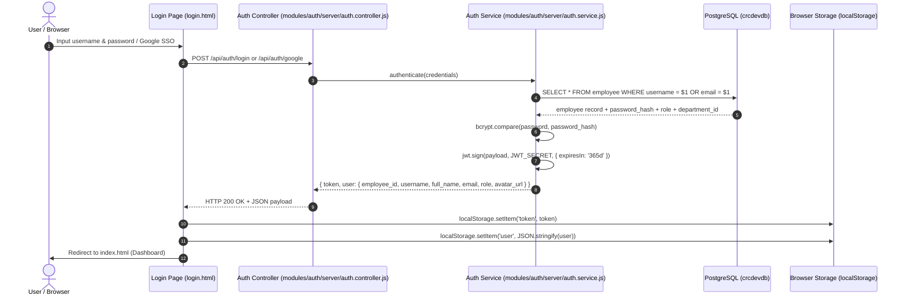
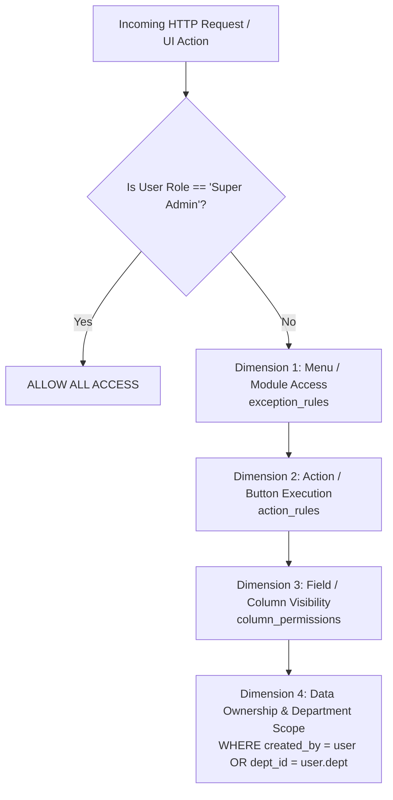

# 08 — AUTHENTICATION & RBAC AUDIT

**Target Repository:** `D:\CPI\teraxV2`  
**Purpose:** Comprehensive audit of authentication lifecycles, session handling, authorization mechanisms, and dynamic 4-dimensional permission matrix for migration to TeraX V3.

---

## 1. Authentication Architecture Overview

TeraX V2 implements a stateless JSON Web Token (JWT) authentication model combined with local credential verification and external Google OAuth2 verification. Session state is not stored in Redis or database tables; validation is performed purely through cryptographic signature verification against `JWT_SECRET`.



---

## 2. Authentication Flow & Lifecycle Deep Dive

### 2.1 Password Hashing & Security Verification
- **Implementation File:** [auth.service.js](file:///d:/CPI/teraxV2/modules/auth/server/auth.service.js)
- **Library:** `bcryptjs`
- **Salt Rounds:** Standard bcrypt hash comparison (`bcrypt.compare(password, employee.password_hash)`).
- **Password Creation/Reset:** In [employee.service.js](file:///d:/CPI/teraxV2/modules/employee/server/employee.service.js) and [auth.service.js](file:///d:/CPI/teraxV2/modules/auth/server/auth.service.js), passwords are encrypted using `bcrypt.hash(password, 10)` before insertion/update into `employee.password_hash`.

### 2.2 Token Generation, Lifespan & Refresh Handling
- **JWT Issuer File:** [auth.service.js](file:///d:/CPI/teraxV2/modules/auth/server/auth.service.js#L54)
- **Token Payload:**
  ```javascript
  const payload = {
    employee_id: user.employee_id,
    username: user.username,
    role: user.role,
    department_id: user.department_id,
    email: user.email
  };
  ```
- **Lifespan Issue:** Tokens are signed with `expiresIn: '365d'`.
  > [!WARNING]
  > **Extreme Token Validity Window:** The JWT is valid for 1 full year without revocation mechanisms. If a token is compromised or an employee is terminated, the token remains valid unless the server's global `JWT_SECRET` is rotated (which would invalidate all active users).
- **Refresh Token Mechanism:** **NONE**. TeraX V2 has no refresh token model, no token rotation table, and no blacklisting cache (Redis).
- **Session Revocation:** Impossible without altering `JWT_SECRET`. Password change does not invalidate outstanding tokens.

### 2.3 Google OAuth SSO Flow
- **Client Implementation:** [public/login.html](file:///d:/CPI/teraxV2/public/login.html)
- **Hardcoded Client ID:** `57927835497-1sv59lihil921e8cg3vpp1fr7oeef7pc.apps.googleusercontent.com`
- **Verification Endpoint:** `POST /api/auth/google` in [auth.controller.js](file:///d:/CPI/teraxV2/modules/auth/server/auth.controller.js)
- **Verification Library:** `google-auth-library` (`OAuth2Client.verifyIdToken`)
- **Matching Rule:** Extracts email from Google token payload; executes `SELECT * FROM employee WHERE email = $1 AND deleted_at IS NULL`. If found, issues standard 365-day internal JWT. If not found, returns `401 Unauthorized ("Email not registered in the system")`. Auto-provisioning is disabled.

### 2.4 Switch User Feature (Critical Security Flaw)
- **Endpoint:** `POST /api/auth/switch-user`
- **File:** [auth.controller.js](file:///d:/CPI/teraxV2/modules/auth/server/auth.controller.js#L68-L95)
- **Mechanism:**
  ```javascript
  // auth.controller.js
  async function switchUser(req, res) {
    const { target_employee_id } = req.body;
    // Authenticated via authenticateToken middleware...
    const employee = await employeeService.getById(target_employee_id);
    const newToken = authService.generateToken(employee);
    return res.json({ success: true, token: newToken, user: employee });
  }
  ```
  > [!CAUTION]
  > **Privilege Escalation Vulnerability:** The endpoint validates that the requester has a valid JWT, but **DOES NOT check if the current user has `Super Admin` or administrative privileges**. Any regular employee who knows or guesses another employee ID (including Super Admin ID 1) can submit `{"target_employee_id": 1}` and obtain a full Super Admin JWT token!

---

## 3. Frontend Authentication State Management

### 3.1 Storage & HTTP Interceptor
- **Client Storage:** `localStorage.getItem('token')` and `localStorage.getItem('user')`
- **Request Interceptor:** [public/js/utils/api.js](file:///d:/CPI/teraxV2/public/js/utils/api.js)
  ```javascript
  const token = localStorage.getItem('token');
  if (token) {
    headers['Authorization'] = `Bearer ${token}`;
  }
  ```
- **Response Handling & Automatic Logout:**
  If an API call returns `401 Unauthorized` or `403 Forbidden`, `api.js` catches the response, triggers `localStorage.clear()`, and redirects the browser to `/login.html?expired=true`.
- **Navigation Guard:** `index.html` executes an immediate inline verification script:
  ```javascript
  if (!localStorage.getItem('token')) {
    window.location.href = '/login.html';
  }
  ```

---

## 4. Authorization & RBAC Architecture

TeraX V2 implements a hybrid **4-Dimensional Permission Matrix** consisting of:
1. System Role (`employee.role`)
2. Module / Menu Exception Rules (`exception_rules`)
3. Button / Action Rules (`action_rules`)
4. Data / Field Level Rules (`column_permissions`)



### 4.1 System Roles
The database enum/string column `employee.role` defines the base classification:
1. `Super Admin`: Bypasses all middleware, permission checks, action gates, and row filters.
2. `Admin`: Administrative operations across department structures and master data.
3. `Manager`: Department-level approval and monitoring capability.
4. `Team Lead`: Operational dispatch and sub-department workflow coordination.
5. `Staff` / `Member`: Basic operational data entry and personal request creation.

---

## 5. The Dynamic 4-Dimensional Permission Engine

### 5.1 Dimension 1: Menu / Module Access (`exception_rules`)
- **Storage Table:** `exception_rules`
- **Backend File:** [permission.service.js](file:///d:/CPI/teraxV2/modules/permissions/server/permission.service.js)
- **Frontend File:** [public/js/utils/permission.js](file:///d:/CPI/teraxV2/public/js/utils/permission.js)
- **Data Schema:**
  | Field | Type | Description |
  |---|---|---|
  | `id` | SERIAL PK | Unique rule identifier |
  | `module_name` | VARCHAR | Target module key (e.g. `request`, `payment`, `employee`) |
  | `target_type` | VARCHAR | Target entity: `role`, `department`, `position`, `employee` |
  | `target_id` | VARCHAR/INT | Target identifier |
  | `permission` | VARCHAR | `allow` or `deny` |

### 5.2 Dimension 2: Action / Button Rules (`action_rules`)
- **Storage Table:** `action_rules`
- **Scope:** Controls visibility and execution permission for specific button actions:
  - `create`, `edit`, `delete`, `export`, `approve`, `reject`, `send_mail`, `duplicate`.
- **Dynamic Context Roles (Dot-Notation):**
  The engine supports contextual ownership checks using dot notation:
  - `[request.sr_owner]`: The action is allowed if `current_user.id === record.sr_owner`.
  - `[request.creator]`: The action is allowed if `current_user.id === record.created_by`.
  - `[request.handler]`: Allowed if user is the assigned ticket/request processor.

### 5.3 Dimension 3: Column / Field-Level Permissions (`column_permissions`)
- **Storage Table:** `column_permissions`
- **Granular Control:** Dictates which fields can be viewed (`read`) or modified (`edit`) on forms and list grids.
- **Subordinate Association Tables:**
  - `permission_levels`: Minimum managerial level required to view field (e.g. salary, cost margins).
  - `permission_positions`: Specific job titles allowed to edit fields.
  - `permission_roles`: Base roles permitted.
  - `permission_exceptions`: Overrides for individual employees.

### 5.4 Dimension 4: Ownership & Departmental Scope (Row-Level Security)
Row-level isolation is enforced via SQL query composition in [base.service.js](file:///d:/CPI/teraxV2/modules/base/server/base.service.js) and module controllers:
- If user is NOT `Super Admin`, `base.service.js` injects:
  - For personal queues: `WHERE t.created_by = $userId OR t.employee_id = $userId`
  - For department queues: `WHERE t.department_id = $userDeptId`
  - For assigned workflows: `WHERE t.id IN (SELECT request_id FROM request_approvers WHERE employee_id = $userId)`

---

## 6. Permission Verification Trace Points

| Location | File Path | Code Mechanism | Action on Failure |
|---|---|---|---|
| Backend Global Auth | `server/middleware/auth.js` | `jwt.verify(token, JWT_SECRET)` | Returns HTTP 401 |
| Backend Permission Guard | `modules/permissions/server/permission.middleware.js` | `checkPermission(module, action)` | Returns HTTP 403 |
| Backend Dynamic Controller | `modules/base/server/base.controller.js` | Evaluates `action_rules` before calling service delete/update | Returns HTTP 403 JSON error |
| Frontend Route Switcher | `public/js/utils/tabRouter.js` | Checks `permission.canAccessModule(tabId)` | Hides tab, shows "Access Denied" toast |
| Frontend Action Buttons | `public/js/components/grid.js` | Inspects `action_rules` before rendering action bar buttons | Button DOM omitted or `disabled` |
| Frontend Form Fields | `public/js/components/modal.js` | Inspects `column_permissions` against active form fields | Field rendered as hidden or `readonly` |

---

## 7. Migration Recommendations for TeraX V3

1. **Token Lifetime & Refresh Rotation:**
   - Migrate from 365-day tokens to short-lived access tokens (15 minutes) + rotating refresh tokens (7 days) stored in HttpOnly cookies.
2. **Immediate Remediation of Switch-User:**
   - Require `Super Admin` permission check and audit log entry for user impersonation.
3. **Casbin / OpenFGA Engine:**
   - Replace the legacy 4-table permission schema (`exception_rules`, `action_rules`, `column_permissions`, `permission_*`) with a formalized policy-based authorization framework (e.g., Casbin or Cedar) for deterministic evaluation.
4. **Server-Side Field Masking:**
   - Implement field masking in the data layer (Prisma / Drizzle middleware) rather than filtering columns in client JS.
