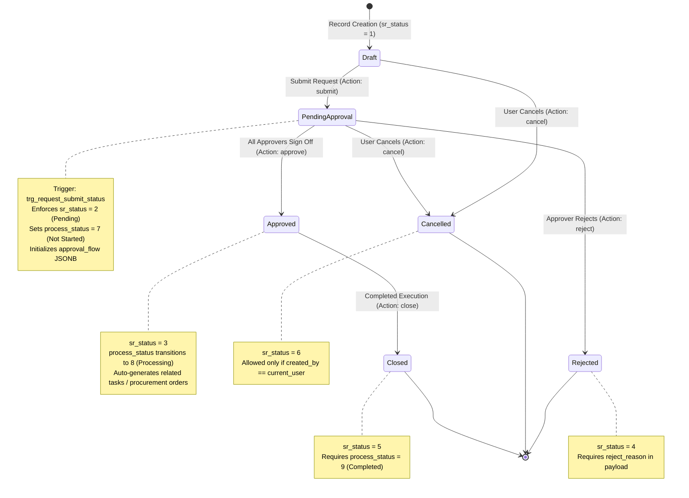
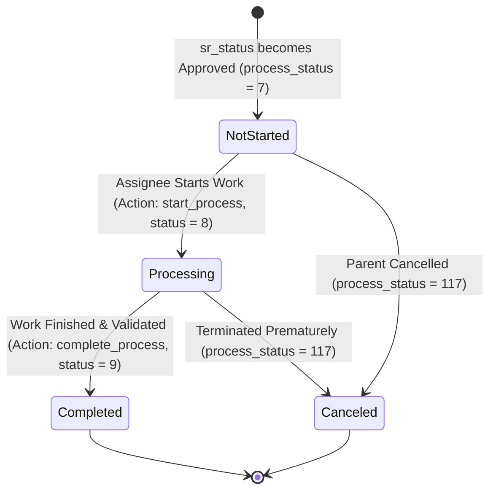
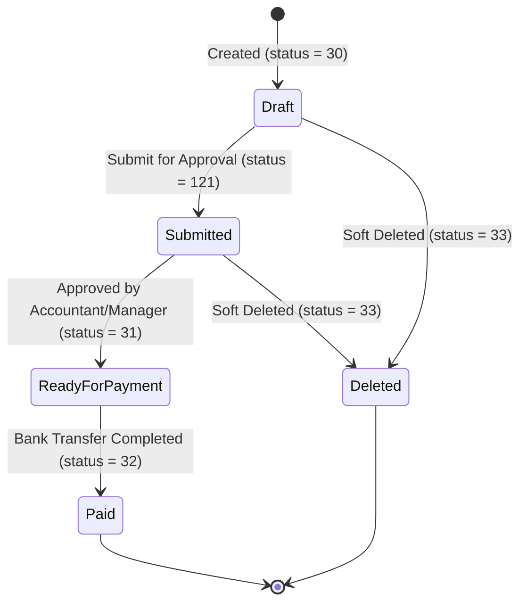
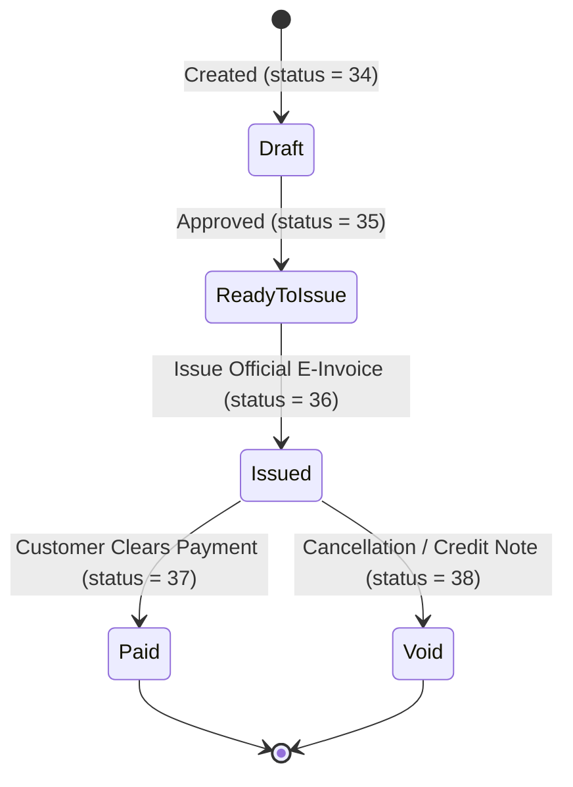
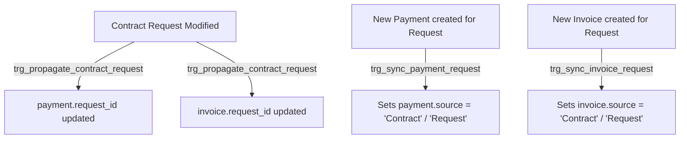

# 09 — WORKFLOW & STATUS AUDIT

**Target Repository:** `D:\CPI\teraxV2`  
**Purpose:** Exhaustive mapping of state machines, approval chains, trigger-based status propagations, and transition constraints across core operational entities for TeraX V3 migration.

---

## 1. Workflow Architecture Overview

TeraX V2 employs a **hybrid status engine (MIXED)**:
- **Code-Driven Transitions:** Initiated via dedicated API action endpoints (`/api/requests/:id/submit`, `/api/requests/:id/approve`, `/api/requests/:id/reject`, `/api/payments/:id/process`) with validations written in Node.js service files.
- **Database Trigger-Driven Transitions:** Enforced atomically via PostgreSQL trigger functions (`trg_request_submit_status`, `trg_propagate_contract_request`, `trg_sync_payment_request`, `trg_sync_invoice_request`).
- **Dynamic Multi-Level Approval State:** Stored inside a JSONB column (`approval_flow`) on the `request` table rather than normalized relational workflow tables.

---

## 2. Request Lifecycle & Dual-Status State Machine

A single Request record maintains **two concurrent state machines**:
1. **Approval Status (`request.sr_status`)**: Manages the governance, review, and budget authorization workflow.
2. **Execution/Process Status (`request.process_status`)**: Manages the physical fulfillment, operational dispatch, and execution.

### 2.1 Approval State Machine (`sr_status`)



#### Detailed Transition Specifications for `sr_status`

| Initial State | Action | Next State | Enforcement Type | Actor / Roles | Business Rules & Prerequisites |
|---|---|---|---|---|---|
| **Draft** (1) | `submit` | **Pending Approval** (2) | **MIXED** (`request.service.js` + `trg_request_submit_status`) | Creator (`created_by`), Owner (`sr_owner`) | Must contain at least 1 line item (`request_items`); total amount must be calculated; department approver must be designated. |
| **Pending Approval** (2) | `approve` | **Approved** (3) or Advance Level | **CODE-DRIVEN** (`request.service.js#approve`) | Designated Approver for `current_level` or `Super Admin` | Advances `approval_flow.current_level`. If `current_level === total_levels`, sets `sr_status = 3` and unlocks execution. |
| **Pending Approval** (2) | `reject` | **Rejected** (4) | **CODE-DRIVEN** (`request.service.js#reject`) | Current Approver or `Super Admin` | Rejection reason string is mandatory; notifies request creator via SSE and in-app alert. Workflow terminates. |
| **Draft** (1) / **Pending** (2) | `cancel` | **Cancelled** (6) | **CODE-DRIVEN** (`request.service.js#cancel`) | Creator or `Super Admin` | Cannot be cancelled once approved (`sr_status = 3`). |
| **Approved** (3) | `close` | **Closed** (5) | **CODE-DRIVEN** (`request.service.js#close`) | Department Manager, Assignee, `Super Admin` | `process_status` must equal 9 (`Completed`) and all financial line items must be balanced. |

---

### 2.2 Execution Process State Machine (`process_status`)



#### Detailed Transition Specifications for `process_status`

| Initial State | Action | Next State | Enforcement Type | Actor / Roles | Business Rules & Prerequisites |
|---|---|---|---|---|---|
| None | Auto-init | **Not Started** (7) | **DB-DRIVEN** (`trg_request_submit_status`) | System | Initialized automatically upon submission or approval. |
| **Not Started** (7) | `start_process` | **Processing** (8) | **CODE-DRIVEN** | Assigned Handler (`handler_id`), `Admin` | Handler accepts task; timestamp `started_at` is set. |
| **Processing** (8) | `complete` | **Completed** (9) | **CODE-DRIVEN** | Assigned Handler, Department Lead | All deliverables/attachments uploaded; verification complete. Enables closing of request. |
| **Any** | `cancel_process` | **Canceled** (117) | **CODE-DRIVEN** | Manager, `Super Admin` | Unlinks pending tasks; logs cancellation reason. |

---

## 3. Dynamic Multi-Level Approval Engine (`approval_flow` JSONB)

### 3.1 Data Schema
Stored in column `request.approval_flow` (JSONB) with structure:

```json
{
  "total_levels": 3,
  "current_level": 1,
  "flow_type": "amount_tiered",
  "steps": [
    {
      "level": 1,
      "name": "Team Lead Approval",
      "approver_role": "Team Lead",
      "approver_id": 14,
      "status": "APPROVED",
      "action_by": 14,
      "action_date": "2026-09-12T08:30:00Z",
      "comment": "Approved within team budget."
    },
    {
      "level": 2,
      "name": "Department Manager",
      "approver_role": "Manager",
      "approver_id": 5,
      "status": "PENDING",
      "action_by": null,
      "action_date": null,
      "comment": null
    },
    {
      "level": 3,
      "name": "General Director / CFO",
      "approver_role": "Super Admin",
      "approver_id": 1,
      "status": "WAITING",
      "action_by": null,
      "action_date": null,
      "comment": null
    }
  ]
}
```

### 3.2 Dynamic Tier Evaluation Rules (Hardcoded in [request.service.js](file:///d:/CPI/teraxV2/modules/request/server/request.service.js))
- **Tier 1 (Amount < 5,000,000 VND):** 1 approval step (Direct Department Lead).
- **Tier 2 (5,000,000 ≤ Amount < 50,000,000 VND):** 2 approval steps (Team Lead $\rightarrow$ Department Manager).
- **Tier 3 (Amount ≥ 50,000,000 VND):** 3 approval steps (Team Lead $\rightarrow$ Department Manager $\rightarrow$ Board of Directors / CFO).

---

## 4. Payment Lifecycle State Machine

- **Target Table:** `payment`
- **Primary Status Column:** `payment.payment_status`



### 4.1 Payment Transition Specifications

| Initial State | Action | Next State | Enforcement | Required Fields / Conditions |
|---|---|---|---|---|
| **Draft** (30) | `submit` | **Submitted** (121) | CODE-DRIVEN | Amount > 0, Beneficiary Name, Bank Account, Department ID. |
| **Submitted** (121) | `approve` | **Ready for Payment** (31) | CODE-DRIVEN | Approval by Chief Accountant or Finance Manager. |
| **Ready for Payment** (31) | `execute_payment` | **Paid** (32) | CODE-DRIVEN | `payment_date` required; transaction reference / bank voucher required. |
| **Draft** (30) / **Submitted** (121) | `delete` | **Deleted** (33) | CODE-DRIVEN | `deleted_at` timestamp stamped; cannot delete if already Paid (32). |

---

## 5. Invoice Lifecycle State Machine

- **Target Table:** `invoice`
- **Primary Status Column:** `invoice.invoice_status`



### 5.1 Invoice Transition Specifications

| Initial State | Action | Next State | Enforcement | Required Fields / Conditions |
|---|---|---|---|---|
| **Draft** (34) | `review` | **Ready to Issue** (35) | CODE-DRIVEN | Tax Code, Company Legal Name, Line Items, VAT calculation verified. |
| **Ready to Issue** (35) | `issue` | **Issued** (36) | CODE-DRIVEN | `invoice_number` and `issue_date` assigned. Triggers customer notification. |
| **Issued** (36) | `record_receipt` | **Paid** (37) | CODE-DRIVEN | Payment receipt matched; remaining balance reaches 0. |
| **Issued** (36) | `cancel_invoice` | **Void** (38) | CODE-DRIVEN | Requires cancellation justification; cannot be un-voided. |

---

## 6. Trigger-Based Cross-Module Workflow Propagations

PostgreSQL triggers automate synchronization across related modules:



1. **`trg_propagate_contract_request`:** When a Contract's linked `request_id` changes, the trigger automatically cascades the new `request_id` to all child payments and invoices attached to that contract.
2. **`trg_sync_payment_request` & `trg_sync_invoice_request`:** Inspects whether the linked request originates from a customer contract or internal operation, auto-populating the `source` field.

---

## 7. Migration Recommendations for TeraX V3

1. **Decouple Dynamic Workflows into Normalized Tables:**
   - Migrate `approval_flow` JSONB out of `request` into dedicated tables: `workflows`, `workflow_steps`, `workflow_executions`, and `workflow_logs`.
2. **Formal State Machine Engine (XState / Temporal):**
   - Replace distributed if/else blocks across service files with explicit, type-safe state machine definitions.
3. **Trigger Elimination:**
   - Deprecate DB triggers (`trg_request_submit_status`, `trg_propagate_contract_request`) in favor of centralized domain events and transactional orchestrators in the backend application layer.
4. **Auditability:**
   - Ensure every status transition records actor, prior state, target state, reason, and cryptographic timestamp in `workflow_history`.
