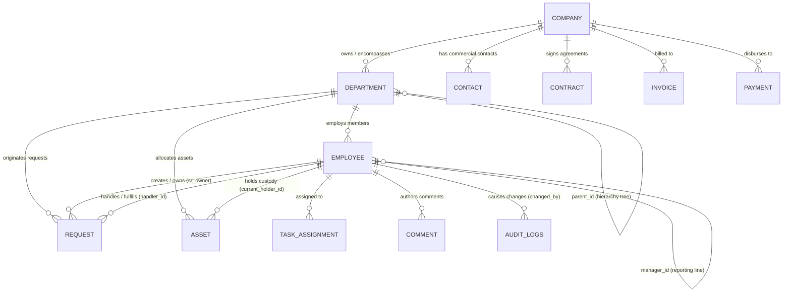
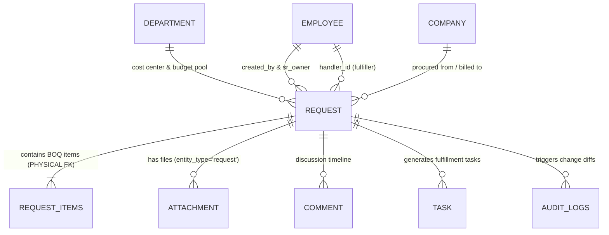
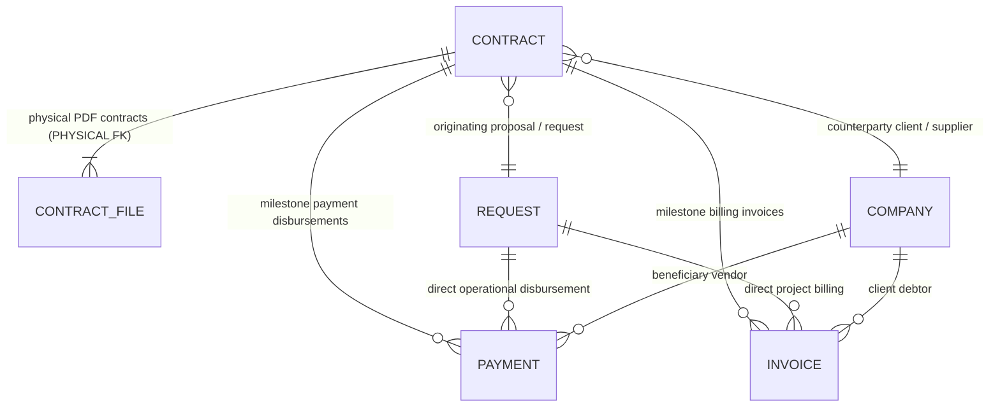
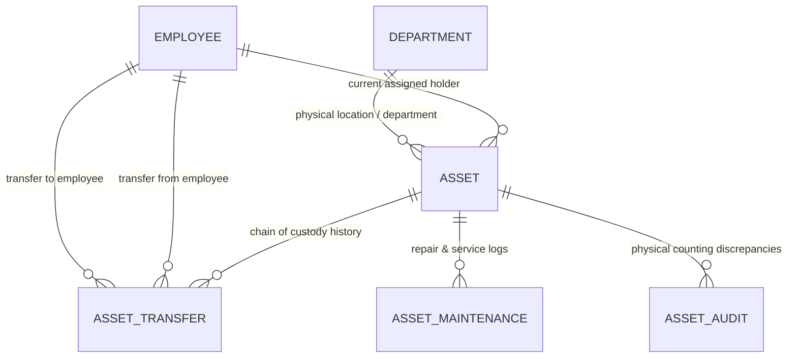
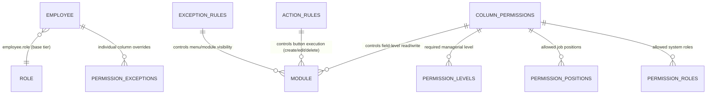

# 11 — DATABASE RELATIONSHIP MAP

**Target Repository:** `D:\CPI\teraxV2`  
**Purpose:** Relational architecture mapping, foreign key topology analysis, and entity-relationship diagrams for migration to TeraX V3.

---

## 1. Relational Integrity Architecture: Physical vs Logical

A critical discovery of this audit is that **over 90% of database relationships in TeraX V2 are LOGICAL, not physical**:
- Only a tiny fraction of tables (`request_items.request_id`, `contract_file.contract_id`) have explicit PostgreSQL `FOREIGN KEY ... REFERENCES ... ON DELETE CASCADE` constraints.
- Crucial entities such as `request.department_id`, `payment.request_id`, `invoice.contract_id`, and `employee.department_id` rely entirely on **application-level code** for referential integrity.
- **Consequence for V3:** Orphaned records exist in production (e.g. payments pointing to deleted requests, employees pointing to non-existent departments). A thorough data cleaning and constraint addition pipeline is mandatory during V3 ETL.

---

## 2. Entity-Relationship Diagrams (ERD)

### 2.1 Organizational & User Hierarchy

---

### 2.2 Operational Core: Request Hub

The `request` table serves as the central operational hub, connecting line items, workflows, tasks, comments, and attachments:

---

### 2.3 Financial & Commercial Flow

Contracts bind companies, incoming customer invoices, and outgoing vendor payments:

---

### 2.4 Fixed Asset Lifecycle & Chain of Custody

---

### 2.5 Security & 4D Authorization Matrix

---

## 3. Relational Anomaly Analysis & Migration Directives

| Relationship Pair | Current V2 State | Risk / Defect in V2 | V3 Architecture Directive |
|---|---|---|---|
| `request` $\rightarrow$ `request_items` | Physical FK with trigger cascade | Soft delete leaves items orphaned in historical reports | Add physical `ON DELETE CASCADE` and unified Prisma/Drizzle soft-delete middleware |
| `payment` $\rightarrow$ `request` | Logical FK (no constraint) | Deleting or merging requests leaves dangling `payment.request_id` | Enforce formal foreign key constraint with `ON DELETE SET NULL` |
| `invoice` $\rightarrow$ `contract` | Logical FK | Contracts can be deleted while active invoices exist | Disallow contract deletion if active child invoices exist |
| `employee` $\rightarrow$ `department` | Logical FK | Disbanding a department leaves employees with invalid `department_id` | Enforce foreign key with `ON DELETE RESTRICT` |
| `asset` $\rightarrow$ `employee` | Logical FK | Terminated employees remain listed as active asset custodians | Add automated custodian reassignment workflow upon employee offboarding |
