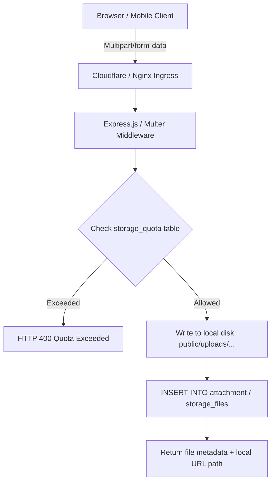

# 14 — FILE & MEDIA STORAGE AUDIT

**Target Repository:** `D:\CPI\teraxV2`  
**Purpose:** Audit of physical and virtual file storage, upload pipelines, MIME type verification, quota enforcement, and local disk coupling for TeraX V3 migration.

---

## 1. Storage Architecture Overview

In TeraX V2, file storage is **100% coupled to local container disk storage**:
- Files uploaded by users are saved directly inside the `public/uploads/` filesystem path.
- The web server serves uploaded files directly as static web assets or streams them via Node.js file controllers.
- There is **no object storage integration** (no AWS S3, Cloudflare R2, MinIO, or Google Cloud Storage).



---

## 2. Directory Hierarchy & File Types

All uploaded assets reside under `public/uploads/` on the local filesystem:

| Subdirectory | Target Entity / File Types | Path Format | Serving Mechanism |
|---|---|---|---|
| `public/uploads/avatars/` | User Profile Pictures (PNG, JPG, WEBP) | `avatar-{employee_id}-{timestamp}.png` | Direct static URL `/uploads/avatars/...` |
| `public/uploads/requests/` | Request Quotations, Invoices, Technical Specs (PDF, XLSX, DOCX) | `requests/{YYYY}/{MM}/{uuid}-{filename}` | Controlled via `/api/storage/download/:id` |
| `public/uploads/contracts/` | Signed Contract PDFs, Annexes, Scanned Documents | `contracts/{YYYY}/{contract_id}/{filename}` | Controlled via `/api/contracts/:id/files` |
| `public/uploads/attachments/` | Universal task & comment attachments | `attachments/{entity_type}/{id}/{filename}` | Streamed via `/api/storage/download/:id` |
| `public/uploads/temp/` | Staging area for chunked uploads & imports | `temp/{upload_session_id}/...` | Temporary, pruned via cron |

---

## 3. Upload Pipeline & Middleware Implementation

### 3.1 Multer Configuration
- **Middleware File:** [server/middleware/upload.js](file:///d:/CPI/teraxV2/server/middleware/upload.js)
- **Engine:** `multer.diskStorage`
- **File Naming Convention:**
  ```javascript
  const storage = multer.diskStorage({
    destination: (req, file, cb) => {
      const folder = determineFolder(req.baseUrl);
      cb(null, path.join(__dirname, '../../public/uploads', folder));
    },
    filename: (req, file, cb) => {
      const sanitizedName = file.originalname.replace(/[^a-zA-Z0-9.-]/g, '_');
      cb(null, `${Date.now()}-${sanitizedName}`);
    }
  });
  ```

### 3.2 File Validation & Security Audit
- **Maximum File Size Limit:** Hardcoded to `25MB` (`limits: { fileSize: 25 * 1024 * 1024 }`).
- **MIME Type Whitelisting:**
  ```javascript
  const ALLOWED_MIMES = [
    'image/jpeg', 'image/png', 'image/webp',
    'application/pdf',
    'application/vnd.openxmlformats-officedocument.spreadsheetml.sheet',
    'application/vnd.openxmlformats-officedocument.wordprocessingml.document',
    'application/zip'
  ];
  ```
- **Security Vulnerability (MIME Spoofing):**
  > [!WARNING]
  > The server inspects `file.mimetype` provided by the client HTTP header, **without inspecting magic bytes** (`file-type` header inspection). An attacker could upload an executable or script disguised with an `image/png` header.

---

## 4. Quota Enforcement System

- **Storage Table:** `storage_quota`
- **Controller/Service:** [modules/storage/server/storage.service.js](file:///d:/CPI/teraxV2/modules/storage/server/storage.service.js)
- **Tracking Algorithm:**
  1. Before writing chunks or finalizing uploads, the service queries:
     ```sql
     SELECT allocated_bytes, used_bytes FROM storage_quota WHERE department_id = $deptId;
     ```
  2. If `used_bytes + incoming_file_size > allocated_bytes`, the upload is rejected with HTTP 400.
  3. Upon successful write, an atomic increment is executed:
     ```sql
     UPDATE storage_quota SET used_bytes = used_bytes + $size WHERE department_id = $deptId;
     ```
- **Flaw:** Concurrent chunk uploads can race on `used_bytes`, leading to slight over-allocation.

---

## 5. Critical Cloud & Container Risks in V2

1. **Kubernetes Ephemeral Disk Loss:**
   - In the Kubernetes deployment ([k8s/deployment.yaml](file:///d:/CPI/teraxV2/k8s/deployment.yaml)), if `public/uploads/` is not backed by a PersistentVolumeClaim (PVC) with `ReadWriteMany` (NFS or Ceph), **every container restart or rolling update will wipe all uploaded contracts, avatars, and invoices**.
2. **Multi-Pod Split-Brain Storage:**
   - With `replicas: 2`, Pod A writes files to its local disk. A subsequent download request routed to Pod B results in `404 Not Found`.

---

## 6. Migration Recommendations for TeraX V3

1. **Decouple from Local Filesystem (S3 / R2 / MinIO):**
   - Completely eliminate `public/uploads/` from application server containers.
   - Adopt an S3-compatible Object Storage layer (Cloudflare R2 for zero-egress fees or AWS S3).
2. **Presigned Upload URLs:**
   - Client requests presigned PUT URL from backend $\rightarrow$ Client uploads directly to Object Storage $\rightarrow$ Client notifies backend of upload completion with S3 key.
   - Eliminates file streaming overhead on Node.js processes, freeing event loop threads.
3. **Magic Byte Verification:**
   - Implement server-side verification using `file-type` library before confirming metadata.
4. **Data Migration Pipeline:**
   - An ETL script must sync all existing files in `public/uploads/` to the target S3 bucket, updating `attachment.file_path` records from relative filesystem paths to S3 URIs or object keys.
