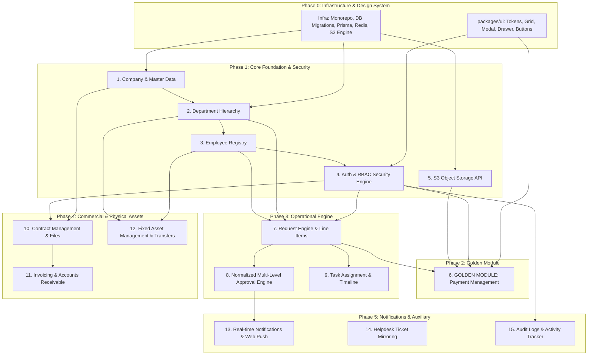

# 19 — MIGRATION DEPENDENCY ORDER & ROADMAP

**Target Repository:** `D:\CPI\teraxV2`  
**Purpose:** Directed Acyclic Graph (DAG) of migration dependencies, topological sequencing, and multi-phase implementation roadmap for TeraX V3.

---

## 1. Dependency Analysis & Constraints

The migration sequence cannot follow arbitrary administrative grouping. It must strictly adhere to **data foreign key constraints**, **business state machine dependencies**, and **API authentication prerequisites**:
1. `employee` requires `department` and `company`.
2. `auth` requires `employee` and `permissions`.
3. `payment` and `invoice` can operate independently or link to `request` and `contract`.
4. `request` requires `department`, `employee` (as `sr_owner` and `handler_id`), and `dropdown_options`.
5. `contract` links `company`, `employee`, and optionally `request`.
6. `asset` requires `employee` and `department`.

---

## 2. Topological Migration Dependency Graph (DAG)

---

## 3. Phased Implementation Roadmap

### Phase 0: Architecture Setup & Shared Libraries
- Setup Monorepo workspace (`D:\CPI\teraxV3`) with Turborepo or pnpm workspaces.
- Initialize database ORM layer (Prisma or Drizzle) targeting PostgreSQL with strict physical foreign key constraints.
- Implement Object Storage client (Cloudflare R2 / AWS S3) with presigned URL generator.
- Setup Redis connection for distributed caching, session revocation, and Pub/Sub.
- Initialize `packages/ui` design system with Tailwind CSS tokens and accessible component primitives (Dialog, Table, Dropdown).

### Phase 1: Core Foundation, Identity & Access
1. **Master Lookups & System Settings:** `dropdown_options`, `system_settings`.
2. **Organization Entities:** `company` $\rightarrow$ `department` $\rightarrow$ `employee`.
3. **Authentication & Session Engine:** Secure JWT issuer (15-min TTL) + Redis refresh token rotation, password hashing, and Google OAuth SSO.
4. **Remediation:** Remove unauthorized `switch-user` vulnerability; implement audited admin impersonation.
5. **Authorization Engine:** Implement Casbin / Cedar policy engine replacing legacy 4D exception tables.

### Phase 2: Golden Module Execution (Payment Management)
- Build backend domain service and REST/tRPC router for `payment`.
- Build frontend payment ledger in `packages/ui` featuring:
  - Universal Data Grid with sorting, search, and status badges.
  - Multi-status disbursement workflow (Draft 30 $\rightarrow$ Submitted 121 $\rightarrow$ Ready 31 $\rightarrow$ Paid 32).
  - Modal form for creating/editing payment vouchers with bank auto-fill.
  - S3 file attachment upload using presigned URLs.
- Conduct architecture review of the Golden Module to validate conventions before scaling.

### Phase 3: Operational Service Request & Approval Engine
1. **Line Items Schema:** Migrate `request` and `request_items`.
2. **Approval Engine Decoupling:** Extract `request.approval_flow` JSONB into normalized relational tables (`workflows`, `workflow_steps`, `workflow_executions`).
3. **Transition Domain Handlers:** Replace `trg_request_submit_status` trigger with explicit backend service orchestrator.
4. **Task Engine:** Implement decoupled `task` and `task_assignment` attached to requests.

### Phase 4: Commercial, Invoicing & Fixed Assets
1. **Contract Management:** Port `contract` and `contract_file`, linking to legal companies and S3 PDFs.
2. **Invoicing (AR):** Port `invoice` with VAT calculations, issuing workflows, and contract cross-linking.
3. **Fixed Assets:** Port `asset`, `asset_transfer`, `asset_maintenance`, and `asset_audit` with custodian history.

### Phase 5: Real-Time Services, External Sync & Analytics
1. **Notifications:** Implement Redis-backed Server-Sent Events (SSE) and VAPID Web Push.
2. **Auxiliary Sync:** Mirror helpdesk tickets from `crc_helpdesk_db` and tenant sync with `cms_terax` using HMAC-SHA256 with replay prevention.
3. **Audit Trails:** Centralize audit logging into PostgreSQL with CDC diff capture.

### Phase 6: Data Migration (ETL) & Production Cutover
1. Develop idempotent SQL/Node.js ETL migration script extracting data from `crcdevdb`/`crc_db` to V3.
2. Cleanse orphaned records (payments pointing to non-existent requests; employees in deleted departments).
3. Migrate physical files from `public/uploads/` to target S3 bucket.
4. Execute dual-write / parallel testing run.
5. Final DNS and Cloudflare cutover; decommission TeraX V2.
