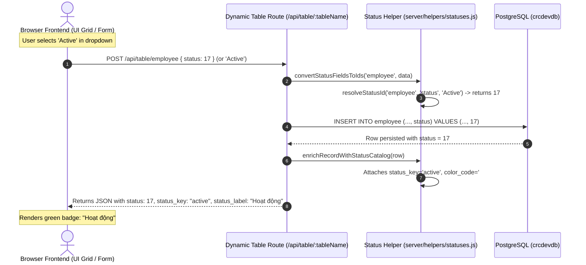

# 23 — ACTIVE STATUS SYSTEM & STATUS CATALOG

**Target Repository:** `D:\CPI\teraxV2`  
**Data Source:** PostgreSQL Database `status_catalog` table & Live Table Column Value Introspection.  
**Status:** **100% VERIFIED AGAINST LIVE DATABASE & RUNTIME CODE**.

---

## 1. Resolution of the Status Ambiguity

### The Problem
Preliminary audit notes exhibited contradictions:
- `employee.status = 'Active'` vs `employee.status = 17`
- `request.sr_status = 'Pending Approval'` vs `request.sr_status = 2`

### The Truth
1. **The Physical Database Storage Type is INTEGER across ALL entities.**
   - In table `employee`, `status` is physically an `INTEGER` column (Default: `17`).
   - Querying the live database returns:
     - `status = 17`: 127 employees
     - `status = 18`: 2 employees
     - There are **ZERO records** containing the string `'Active'`.
2. **Where does `'Active'` come from?**
   - The string `'Active'` is purely the **UI DISPLAY LABEL** defined in `status_catalog.display_name_en` and frontend module configs (`organization.config.js:191`: `options: [{ value: 17, label: 'Active' }, { value: 18, label: 'Inactive' }]`).
   - In legacy query parameters (e.g. `/api/employees?status=Active`), the backend controller intercepts the string and runs `resolveStatusId('employee', 'status', 'Active')` from [server/helpers/statuses.js](file:///d:/CPI/teraxV2/server/helpers/statuses.js) which converts `'Active'` $\rightarrow$ `17`.
3. **Active Implementation:**
   - **Database Layer:** Strictly **INTEGER IDs** (`17`, `18`).
   - **Backend Layer:** Translates between strings and integer IDs via `server/helpers/statuses.js` using `STATUS` dictionary.
   - **Frontend Layer:** Receives integer IDs from API; uses `status_catalog` metadata or module configs to render localized badges (`display_name_vi` / `display_name_en`) with matching `color_code`.

---

## 2. Core Entity Status Catalog (Live Production Baseline)

| Entity / Table | Column Name | Physical DB Type | Actual Live Values in DB | Display Label (EN / VI) | Status Key | Hex Color | Business Meaning |
|---|---|---|---|---|---|---|---|
| **`employee`** | `status` | `INTEGER` | **`17`** (127 rows) **`18`** (2 rows) | Active / Hoạt động Inactive / Không hoạt động | `active` `inactive` | `#10b981` `#ef4444` | Employee active in directory and permitted to log in; inactive accounts are locked. |
| **`request`** | `sr_status` | `INTEGER` | **`1`** (64 rows) **`2`** (125 rows) **`3`** (551 rows) **`5`** (8,695 rows) `4` (0 rows) `6` (0 rows) | Draft / Bản nháp Pending Approval / Chờ duyệt Approved / Đã duyệt Rejected / Từ chối Closed / Đã đóng Cancelled / Đã hủy | `draft` `pending_approval` `approved` `rejected` `closed` `cancelled` | `#64748b` `#3b82f6` `#10b981` `#ef4444` `#64748b` `#ef4444` | Governance approval lifecycle. `2` initiates approval workflow; `3` unlocks task creation; `5` marks full completion and archiving. |
| **`request`** | `process_status` | `INTEGER` | **`7`** (334 rows) **`8`** (405 rows) **`9`** (8,608 rows) **`117`** (88 rows) | Not started yet / Chưa bắt đầu Processing / Đang xử lý Completed / Đã hoàn thành Canceled / Đã hủy | `not_started` `processing` `completed` `canceled` | `#64748b` `#3b82f6` `#10b981` `#ef4444` | Operational execution lifecycle. Managed independently from `sr_status`. |
| **`payment`** | `payment_status` | `INTEGER` | **`30`** (10 rows) **`31`** (975 rows) **`32`** (7,386 rows) **`33`** (1 row) `121` (0 rows) | Draft / Bản nháp Ready for payment / Sẵn sàng thanh toán Paid / Đã thanh toán Deleted / Đã xóa Submitted for payment / Chờ duyệt thanh toán | `draft` `ready_for_payment` `paid` `deleted` `submitted_for_payment` | `#64748b` `#3b82f6` `#10b981` `#ef4444` `#f59e0b` | Disbursement voucher states. `31` requires approval; `32` requires linking an active MTR bank transaction. |
| **`payment`** | `payment_type` | `INTEGER` | `60` `61` (Default) | Incoming / Khoản thu Outgoing / Khoản chi | `incoming` `outgoing` | `#10b981` `#f59e0b` | Financial cashflow direction. Outgoing payments trigger sub-requests. |
| **`invoice`** | `invoice_status` | `INTEGER` | **`34`** (741 rows) **`35`** (3,009 rows) **`36`** (10 rows) **`38`** (18 rows) `37` (0 rows) `39` (0 rows) | Draft / Bản nháp Ready to issue / Sẵn sàng xuất Issued / Đã xuất Paid / Đã thanh toán Void / Bị hủy Deleted / Đã xóa | `draft` `ready_to_issue` `issued` `paid` `void` `deleted` | `#64748b` `#3b82f6` `#3b82f6` `#10b981` `#ef4444` `#ef4444` | Billing invoice lifecycle. `36` assigns tax invoice number; `37` clears balance. |
| **`contract`** | `type` | `INTEGER` | `69` `70` `71` | Selling / Bán ra Buying / Mua vào Internal / Nội bộ | `selling` `buying` `internal` | `#10B981` `#EF4444` `#6366F1` | Contract commercial classification governing invoice and payment direction. |
| **`mtr`** | `status` | `INTEGER` | `55` `56` | Draft / Bản nháp Approved / Đã duyệt | `draft` `approved` | `#64748b` `#10b981` | Bank transaction reconciliation state. Unmatched lines are `55`. |
| **`account`** | `account_status` | `INTEGER` | **`19`** (43 rows) **`20`** (5 rows) | Active / Hoạt động Inactive / Không hoạt động | `active` `inactive` | `#10b981` `#ef4444` | Bank / cash account availability for payments and transaction matching. |
| **`my_company`**| `status` | `INTEGER` | **`67`** (6 rows) **`68`** (2 rows) | Active / Hoạt động Inactive / Ngưng hoạt động | `active` `inactive` | `#10b981` `#ef4444` | Tenant corporate entity active status. |
| **`assigned_task`**| `status` | `INTEGER` | `62` `63` `64` | Not started yet / Chưa bắt đầu Processing / Đang xử lý Completed / Hoàn thành | `not_started` `processing` `completed` | `#64748b` `#3b82f6` `#10b981` | Task execution lifecycle for operational assignees. |
| **`asset`** | `status` | `INTEGER` | `21`..`25` | Draft $\rightarrow$ Pending $\rightarrow$ In Progress $\rightarrow$ Approved $\rightarrow$ Completed | `draft`..`completed` | Varied | Fixed asset procurement and custody status. |

---

## 3. Status Transformation & Resolution Pipeline

---

## 4. Recommendations for TeraX V3 Migration

1. **Eliminate Magic Numbers in V3:**
   - Migrate integer status codes (`17`, `1`, `7`, `30`, `31`) to **type-safe string enums** (`ACTIVE`, `DRAFT`, `PENDING_APPROVAL`, `PAID`) using PostgreSQL native `ENUM` or TypeScript string literal types in Prisma/Drizzle.
2. **Automated ETL Status Conversion Script:**
   - Create a deterministic mapping table from V2 integer IDs to V3 string enums during data migration.
3. **Decouple Labels into i18n Dictionary:**
   - Eliminate hardcoded `display_name_vi` and `display_name_en` columns in the database; manage display strings purely within the frontend translation dictionary (`i18n.json`).
