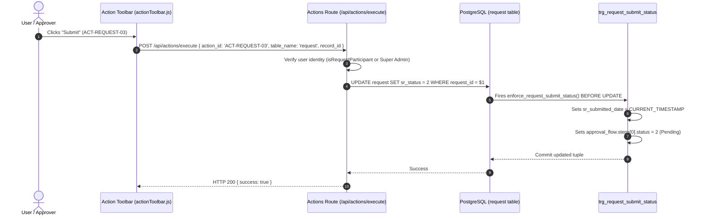

# 24 — ACTIVE WORKFLOW & STATE TRANSITION TRACE

**Target Repository:** `D:\CPI\teraxV2`  
**Execution Context:** Code trace of active action execution pipeline in `server/routes/actions.js`, frontend invocation sites in `public/js/components/actionToolbar.js`, and database trigger interactions in PostgreSQL `crcdevdb`.  
**Status:** **100% VERIFIED FROM RUNTIME CODE & LIVE DATABASE TRIGGERS**.

---

## 1. Unified Action Execution Architecture

In TeraX V2, all workflow state transitions are centralized through a single unified command gateway:
- **API Endpoint:** `POST /api/actions/execute`
- **Route Handler:** [server/routes/actions.js](file:///d:/CPI/teraxV2/server/routes/actions.js#L544)
- **Payload Schema:**
  ```typescript
  interface ActionExecutePayload {
    action_id: string;        // e.g. "ACT-REQUEST-03", "approve_request", "payment_paid"
    table_name: string;       // e.g. "request", "payment"
    record_id: string;        // e.g. "REQ-260904-001", "PAY-260904-001"
    view?: string | null;     // e.g. "my_request", "my_team", "finance"
    data?: any;               // Action-specific input (ratings, comments, transaction_id)
  }
  ```

---

## 2. Request Workflow Action Traces



### 2.1 Trace: Request Submit (`ACT-REQUEST-03` / `ACT-REQUEST-09`)
1. **Frontend Trigger:** User clicks "Submit" button rendered by `actionToolbar.js` when `sr_status === 1` (Draft).
2. **API Endpoint:** `POST /api/actions/execute`
3. **Active Route File:** `server/routes/actions.js`
4. **Service / Handler:** Evaluates `isRequestParticipant(record, user)`; validates mandatory fields.
5. **SQL Executed:**
   ```sql
   UPDATE request 
   SET sr_status = 2, log = COALESCE(log, '[]'::jsonb) || $2::jsonb 
   WHERE request_id = $1;
   ```
6. **Active Database Trigger:** `trg_request_submit_status` fires `enforce_request_submit_status()`:
   - Sets `NEW.sr_submitted_date = CURRENT_TIMESTAMP`.
   - Modifies `NEW.approval_flow`: sets first step status to `2` (Pending Approval).
7. **Affected Tables:** `request`, `audit_logs` (via `trg_audit_log`).

---

### 2.2 Trace: Request Approve (`approve_request`)
1. **Frontend Trigger:** User clicks "Approve" button; optional approval comment modal shown.
2. **API Endpoint:** `POST /api/actions/execute`
3. **Active Route File:** `server/routes/actions.js`
4. **Service / Handler:**
   - Parses `request.approval_flow` JSONB.
   - Verifies `current_user.employee_id === flow.steps[current_level - 1].approver` (or `Super Admin`).
   - Marks current step status as `3` (Approved), records `action_by` and `action_date`.
   - If `current_level < total_levels`: increments `current_level += 1`, sets next step status to `2` (Pending).
   - If `current_level === total_levels`: sets `sr_status = 3` (Approved), `process_status = 8` (Processing).
5. **SQL Executed:**
   ```sql
   UPDATE request 
   SET approval_flow = $2::jsonb, 
       sr_status = $3, 
       process_status = $4,
       log = COALESCE(log, '[]'::jsonb) || $5::jsonb 
   WHERE request_id = $1;
   ```
6. **Active Database Trigger:** `trg_audit_log` records state transition diff.
7. **Affected Tables:** `request`, `audit_logs`.

---

### 2.3 Trace: Request Reject (`reject_request`)
1. **Frontend Trigger:** User clicks "Reject" button; mandatory rejection reason prompt.
2. **API Endpoint:** `POST /api/actions/execute`
3. **Active Route File:** `server/routes/actions.js`
4. **Service / Handler:**
   - Enforces non-empty rejection comment: `if (!comment.trim()) throw new Error("Vui lòng nhập lý do từ chối")`.
   - Updates `approval_flow.steps[current_level - 1].status = 4` (Rejected).
   - Sets `sr_status = 4` (Rejected).
5. **SQL Executed:**
   ```sql
   UPDATE request 
   SET approval_flow = $2::jsonb, 
       sr_status = 4, 
       log = COALESCE(log, '[]'::jsonb) || $3::jsonb 
   WHERE request_id = $1;
   ```
6. **Affected Tables:** `request`, `audit_logs`.

---

### 2.4 Trace: Request Cancel / Withdraw (`withdraw_request` & `ACT-REQUEST-05`)
- **`withdraw_request` (Revert to Draft):**
  - Allowed when `sr_status === 2` and requester withdraws before review.
  - Resets `sr_status = 1` (Draft), resets `approval_flow.current_level = 1`, resets all steps to `7` (Not started yet).
- **`ACT-REQUEST-05` (Permanent Cancellation):**
  - Sets `sr_status = 5` (Closed), `process_status = 117` (Canceled), `sr_close_date = CURRENT_TIMESTAMP`.
  - Automation Cascade: If linked to a Payment Request (`request_type === '5'`), reverts linked payment back to `payment_status = 30` (Draft) and clears `payment.payment_request`.

---

### 2.5 Trace: Request Start Process (`ACT-REQUEST-08`)
1. **Frontend Trigger:** Assignee/Handler clicks "Start Process" button.
2. **API Endpoint:** `POST /api/actions/execute`
3. **SQL Executed:**
   ```sql
   UPDATE request 
   SET process_status = 8, 
       process_start_date = CURRENT_TIMESTAMP, 
       log = COALESCE(log, '[]'::jsonb) || $2::jsonb 
   WHERE request_id = $1;
   ```
4. **Automation Hook:** If `request.request_type === '5'` (Payment Request), automatically updates linked payment:
   ```sql
   UPDATE payment SET payment_status = 31 WHERE payment_request = $1;
   ```
5. **Affected Tables:** `request`, `payment`, `audit_logs`.

---

### 2.6 Trace: Request Complete Process (`ACT-REQUEST-07`)
1. **Frontend Trigger:** Assignee clicks "Complete" button when `sr_status === 3` and `process_status === 8`.
2. **API Endpoint:** `POST /api/actions/execute`
3. **SQL Executed:**
   ```sql
   UPDATE request 
   SET process_status = 9, 
       process_end_date = CURRENT_TIMESTAMP, 
       log = COALESCE(log, '[]'::jsonb) || $2::jsonb 
   WHERE request_id = $1;
   ```
4. **Affected Tables:** `request`, `audit_logs`.

---

### 2.7 Trace: Request Rating (`ACT-REQUEST-08` / Rating Dialog)
1. **Frontend Trigger:** Requester submits star ratings and feedback.
2. **API Endpoint:** `POST /api/actions/execute` with `data: { ratings: [{ to_user, point, comment }] }`
3. **Validation:** Validated against `ratingsDataSchema` using Zod (`point >= 1`, comment required if `point < 3`).
4. **SQL Executed:**
   ```sql
   INSERT INTO request_rating (id, request_id, from_user, to_user, point, comment, created_at)
   VALUES (gen_random_uuid(), $1, $2, $3, $4, $5, CURRENT_TIMESTAMP);
   ```
5. **Affected Tables:** `request_rating`, `request` (caches average rating in `request.rating` JSONB).

---

## 3. Payment Workflow Action Traces

### 3.1 Trace: Submit for Payment (`payment_req_outgoing`)
1. **Frontend Trigger:** In payment grid/detail, user clicks "Submit for Payment".
2. **API Endpoint:** `POST /api/actions/execute` (`action_id: 'payment_req_outgoing'`, `table_name: 'payment'`)
3. **Business Logic & ID Generation:**
   - Generates sequential request code: `5-{DDMMYY}-{INITIALS}-{001}`.
   - Reads policy rules for Payment Request (`policy_id = '5'`).
4. **SQL Executed (Transactional Block):**
   ```sql
   -- 1. Create linked Request
   INSERT INTO request (
     request_id, request_type, sr_creater, requester, description,
     policy_lead, sr_owner, sr_status, process_status, approval_flow, company_id
   ) VALUES ($1, '5', $2, $3, $4, $5, $6, 2, 7, $7::jsonb, $8);

   -- 2. Update Payment Status and link request
   UPDATE payment 
   SET payment_status = 31, 
       payment_request = $1, 
       log = COALESCE(log, '[]'::jsonb) || $2::jsonb 
   WHERE payment_id = $3;
   ```
5. **Active Triggers:** `trg_request_submit_status` on `request`; `trg_audit_log` on `payment` and `request`.
6. **Affected Tables:** `request`, `payment`, `audit_logs`.

---

### 3.2 Trace: Ready for Payment (`payment_ready`)
1. **Frontend Trigger:** Finance Manager approves disbursement.
2. **API Endpoint:** `POST /api/actions/execute` (`action_id: 'payment_ready'`)
3. **SQL Executed:**
   ```sql
   UPDATE payment SET payment_status = 31 WHERE payment_id = $1;
   ```
4. **Affected Tables:** `payment`, `audit_logs`.

---

### 3.3 Trace: Mark Payment as Paid (`payment_paid`)
1. **Frontend Trigger:** Cashier/Accountant clicks "Mark as Paid"; modal prompts for MTR Transaction selection.
2. **API Endpoint:** `POST /api/actions/execute` with `data: { transaction_id: 'TXN-...', payment_date: 'YYYY-MM-DD' }`
3. **Service Validation:**
   - Verifies `transaction_id` exists in table `mtr`.
   - Verifies current user has access to `account.finance_control` or `account.transaction_managed_by` for the bank account linked to the MTR.
4. **SQL Executed:**
   ```sql
   UPDATE payment 
   SET payment_status = 32, 
       transaction_id = $1, 
       payment_date = COALESCE($2, (SELECT transaction_date FROM mtr WHERE transaction_id = $1)),
       log = COALESCE(log, '[]'::jsonb) || $3::jsonb 
   WHERE payment_id = $4;
   ```
5. **Affected Tables:** `payment`, `audit_logs`.

---

### 3.4 Trace: Change MTR Transaction (`payment_change_mtr`)
1. **Frontend Trigger:** Accountant reselects transaction for an already paid payment (`action_rules` seeds `payment_change_mtr`).
2. **API Endpoint:** `POST /api/actions/execute` with `data: { transaction_id: 'NEW-TXN-...' }`
3. **SQL Executed:**
   ```sql
   UPDATE payment 
   SET transaction_id = $1, 
       payment_date = (SELECT transaction_date FROM mtr WHERE transaction_id = $1),
       log = COALESCE(log, '[]'::jsonb) || $2::jsonb 
   WHERE payment_id = $3;
   ```
4. **Affected Tables:** `payment`, `audit_logs`.
