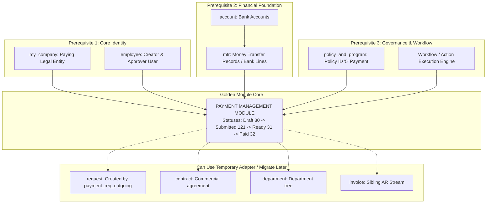

# 25 — GOLDEN MODULE RUNTIME DEPENDENCY VERIFICATION

**Target Repository:** `D:\CPI\teraxV2`  
**Target Module:** Payment Management (`payment`)  
**Context:** Runtime code and database dependency verification to determine exact prerequisites for migrating Payment as the Golden Module for TeraX V3.  
**Status:** **100% VERIFIED FROM RUNTIME CODE & DB SCHEMA**.

---

## 1. Executive Dependency Verdict

In TeraX V2, the Payment module is **not an isolated CRUD table**. Its full runtime behavior is tightly integrated into:
1. **Corporate & User Identity** (`my_company`, `employee`)
2. **Bank Reconciliation** (`account`, `mtr`)
3. **Operational Request Creation** (`request`, `policy_and_program`)
4. **Action Workflow Engine** (`action_rules`, `/api/actions/execute`)

---

## 2. Granular Dependency Matrix for Payment

| Entity / System | Physical Coupling in V2 | Runtime Code Requirement in V2 | Migration Classification | Practical Handling during V3 Phase 1 |
|---|---|---|---|---|
| **`employee`** | `payment.employee`, `payment.updated_by` | Required for user identity, action auditing, and the `employee_related` filter query. | **REQUIRED BEFORE PAYMENT** | Must exist so authenticated user can submit, approve, and execute disbursements. |
| **`my_company`** | `payment.my_company` | Required for entity isolation and display name resolution in table queries. | **REQUIRED BEFORE PAYMENT** | Must exist to bind disbursements to the correct paying legal entity. |
| **`account`** | `mtr.account` | Required as bank account container; checked during `payment_paid` permissions check (`finance_control`). | **REQUIRED BEFORE PAYMENT** | Basic bank account master data must be seeded before bank transactions can exist. |
| **`mtr`** | `payment.transaction_id` | **Strict Runtime Blocker:** Action `payment_paid` explicitly requires `transaction_id`: `if (!transaction_id) throw new Error("Vui lòng chọn MTR Transaction")`. | **REQUIRED BEFORE PAYMENT** | MTR bank transaction table must be migrated alongside Payment to allow marking disbursements as "Paid". |
| **`policy_and_program`** | Seeded Policy `'5'` ("Payment") | Action `payment_req_outgoing` reads Policy `'5'` to fetch approvers (`tier1_approval`, `tier2_approval`, `policy_lead`, `sr_owner`). | **REQUIRED BEFORE PAYMENT** | Seed Policy ID `'5'` minimal row into configuration or database. |
| **`Workflow` (Actions)** | `action_rules` table & `/api/actions/execute` | Handles `payment_req_outgoing`, `payment_ready`, `payment_paid`, and `payment_change_mtr`. | **REQUIRED BEFORE PAYMENT** | V3 Action/Workflow engine must support the Payment state machine transitions. |
| **`request`** | `payment.request`, `payment.payment_request` | `payment_req_outgoing` executes `INSERT INTO request` creating a linked request. | **CAN USE ADAPTER/STUB TEMPORARILY** | For Phase 1, can stub request creation or create basic Payment CRUD, but full `payment_req_outgoing` requires Request schema. |
| **`contract`** | `payment.contract_id` | Payments can link to contracts; `trg_sync_payment_request` checks contract existence. | **CAN USE ADAPTER/STUB TEMPORARILY** | `contract_id` is nullable in `payment`; standalone payments function completely without contracts. |
| **`department`** | Indirect association | Department filtering is inherited from employee or parent request. | **CAN USE ADAPTER/STUB TEMPORARILY** | Can stub department or migrate with Organization foundation. |
| **`invoice`** | None (Sibling in `v_finance`) | No direct coupling between Payment and Invoice. | **CAN MIGRATE AFTER PAYMENT** | Invoicing can be built completely independently after Payment. |

---

## 3. Dependency Architecture Topology

---

## 4. Definitive Implementation Recommendation for V3

To ensure the Payment module functions with **100% fidelity to V2 behavior**, the implementation must execute in this precise sequence:

1. **Step 1:** Establish `my_company` and `employee` with authentication context.
2. **Step 2:** Establish `account` and `mtr` (Money Transfer Records) so that bank transaction reconciliation is available.
3. **Step 3:** Seed Policy `'5'` (Payment Request) and initialize the Action Execution Engine.
4. **Step 4:** Implement **Payment Management (`payment`)**:
   - Universal Grid (`/api/table/payment`)
   - Create/Edit Modal with `payment_term` validation and base currency conversion
   - Action `payment_ready`
   - Action `payment_paid` (binding `transaction_id`)
   - Action `payment_change_mtr`
5. **Step 5 (Integration Slice):** Connect `payment_req_outgoing` to the Service Request engine once `request` is migrated.
