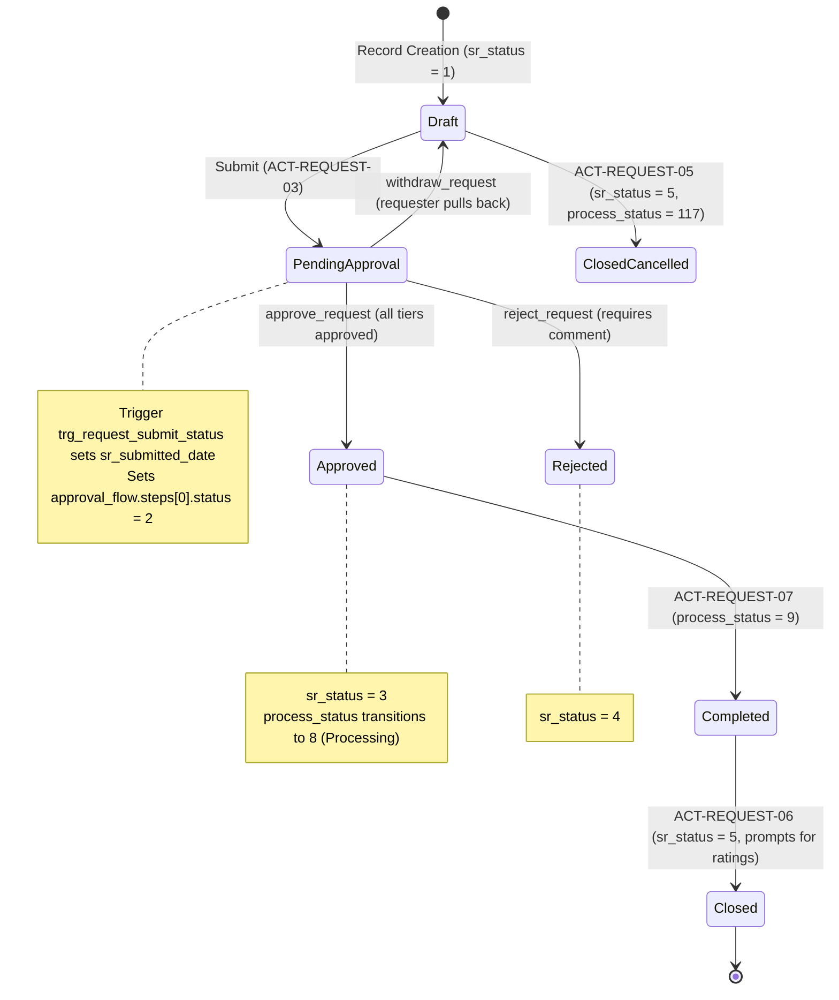
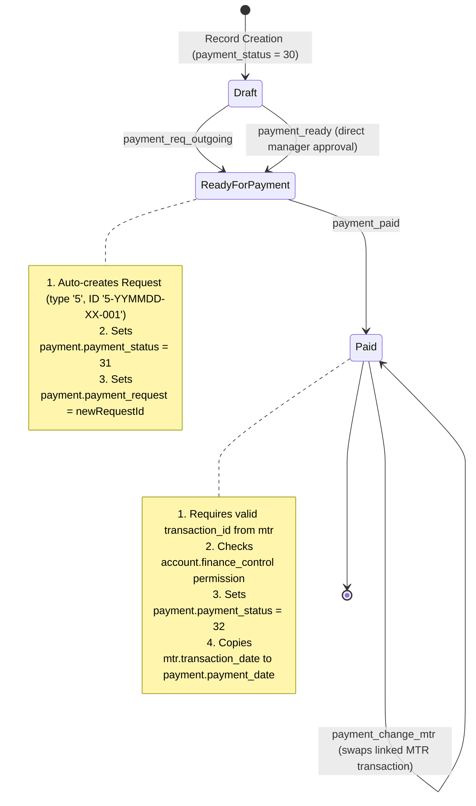
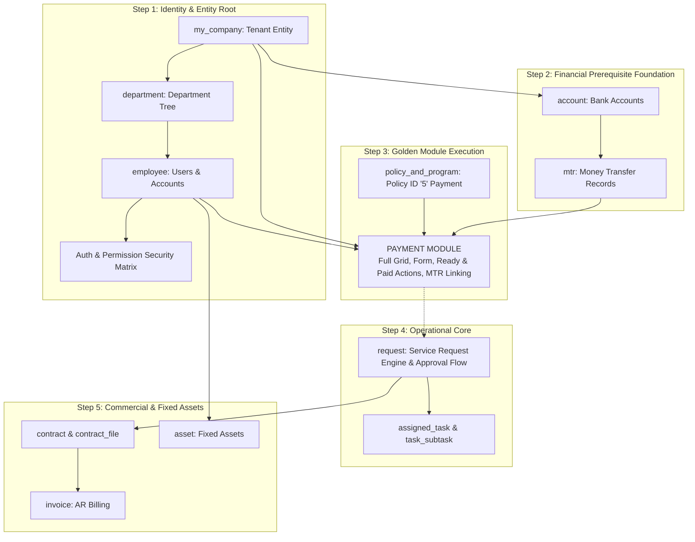

# 26 — V3 MIGRATION SOURCE OF TRUTH (VERIFIED BASELINE)

**Target System:** TeraX V2 (`D:\CPI\teraxV2`) $\rightarrow$ Migration Target: TeraX V3 (`D:\CPI\teraxV3`)  
**Database Verified:** `crcdevdb` on PostgreSQL 18.4 (`10.91.1.100:30543`)  
**Status:** **100% CANONICAL SOURCE OF TRUTH**. Every claim in this document is backed by code inspection, runtime routing, or direct live database queries.

---

## 1. Evidence Verification Legend

- `[VERIFIED_FROM_RUNTIME]`: Proved via active entrypoint (`server/index.js`), route execution, middleware pipeline, or active JavaScript services.
- `[VERIFIED_FROM_DATABASE]`: Proved via live read-only SQL introspection of `information_schema`, `pg_catalog`, or table rows in `crcdevdb`.
- `[VERIFIED_FROM_FRONTEND_USAGE]`: Proved via client HTTP call sites in `public/js/core/api.js`, `public/js/views/`, or `public/login.html`.
- `[NOT_VERIFIED]`: Items that could not be proved from active code or database and are explicitly flagged.

---

## 2. Canonical Active API Architecture

| API Domain | Canonical Mounted Path | Underlying Handler File | Verification Evidence |
|---|---|---|---|
| **Universal Data Engine** | `GET, POST, PUT, DELETE /api/table/:tableName` | `server/routes/dynamic_crud.js` | `[VERIFIED_FROM_RUNTIME]` + `[VERIFIED_FROM_FRONTEND_USAGE]` |
| **Workflow Actions Gateway** | `GET /api/actions/:table/:id` `POST /api/actions/execute` | `server/routes/actions.js` | `[VERIFIED_FROM_RUNTIME]` + `[VERIFIED_FROM_FRONTEND_USAGE]` |
| **Authentication & Profile** | `POST /api/auth/login` `GET /api/auth/me` `POST /api/auth/google` | `server/modules/identity/auth.router.js` | `[VERIFIED_FROM_RUNTIME]` + `[VERIFIED_FROM_FRONTEND_USAGE]` |
| **Permission Matrix** | `GET /api/permissions/user-permissions` | `server/modules/identity/permissions.router.js` | `[VERIFIED_FROM_RUNTIME]` + `[VERIFIED_FROM_FRONTEND_USAGE]` |
| **Personal Queues** | `GET /api/my-views/:viewName` | `server/routes/myViews.js` | `[VERIFIED_FROM_RUNTIME]` + `[VERIFIED_FROM_FRONTEND_USAGE]` |
| **Organization Directory** | `/api/departments` `/api/employees` `/api/companies` `/api/contacts` `/api/my-company` | `server/modules/organization/` routers | `[VERIFIED_FROM_RUNTIME]` |
| **Policies & Programs** | `/api/policies` | `server/routes/policy.js` | `[VERIFIED_FROM_RUNTIME]` |
| **Realtime Stream (SSE)** | `GET /api/stream?token=...` | `server/index.js:305` $\rightarrow$ `server/helpers/sseHelper.js` | `[VERIFIED_FROM_RUNTIME]` + `[VERIFIED_FROM_FRONTEND_USAGE]` |
| **Multi-Part Uploads** | `POST /api/upload-chunk` `POST /api/upload-binary` | `server/index.js:219-300` | `[VERIFIED_FROM_RUNTIME]` + `[VERIFIED_FROM_FRONTEND_USAGE]` |

> [!CAUTION]
> **Definitive Finding:** `/api/base/:module` DOES NOT EXIST in the active codebase. Any references to `/api/base` in early draft documents were errors and are classified as **`LEGACY_FICTION`**. The true canonical CRUD API for TeraX V2 is **`/api/table/:tableName`**.

---

## 3. Canonical Database Schema (Live PostgreSQL Baseline)

`[VERIFIED_FROM_DATABASE]`

Total Live Database Scope: **44 Base Tables** + **2 Views** (`v_department`, `v_finance`).

### 3.1 Primary Keys & Key Column Types of Core Entities

| Table Name | Primary Key Column | PK Data Type | Physical Status Column & Type | Soft Delete Column |
|---|---|---|---|---|
| **`employee`** | `employee_id` | `VARCHAR` (e.g. `EMP-001`) | `status` (`INTEGER`, default `17`) | `deleted_at` (`TIMESTAMP`) |
| **`request`** | `request_id` | `VARCHAR` (e.g. `REQ-260904-001`) | `sr_status` (`INTEGER`, default `1`) `process_status` (`INTEGER`, default `7`) | `deleted_at` (`TIMESTAMP`) |
| **`payment`** | `payment_id` | `VARCHAR` (e.g. `PAY-260904-001`) | `payment_status` (`INTEGER`, default `30`) `payment_type` (`INTEGER`, default `61`) | `deleted_at` (`TIMESTAMP`) |
| **`invoice`** | `invoice_id` | `VARCHAR` (e.g. `INV-260904-001`) | `invoice_status` (`INTEGER`, default `34`) | `deleted_at` (`TIMESTAMP`) |
| **`contract`** | `contract_id` | `VARCHAR` (e.g. `CON-260904-001`) | `type` (`INTEGER`, default `69`) | `deleted_at` (`TIMESTAMP`) |
| **`mtr`** | `transaction_id` | `VARCHAR` (e.g. `TXN-2026-0091`) | `status` (`INTEGER`, default `55`) | `deleted_at` (`TIMESTAMP`) |
| **`account`** | `account_id` | `VARCHAR` (e.g. `ACC-VCB-01`) | `account_status` (`INTEGER`, default `19`) | `deleted_at` (none) |
| **`my_company`**| `my_company_id` | `VARCHAR` (e.g. `1`) | `status` (`INTEGER`, default `67`) | `deleted_at` (`TIMESTAMP`) |
| **`department`**| `department_id` | `VARCHAR` (e.g. `DEP-TECH`) | None (`deleted_at` controls lifecycle) | `deleted_at` (`TIMESTAMP`) |
| **`policy_and_program`** | `policy_id` | `VARCHAR` (e.g. `'5'`) | None | `deleted_at` (`TIMESTAMP`) |

### 3.2 Physical vs Logical Foreign Key Reality

`[VERIFIED_FROM_DATABASE]`
- **The only 5 physical foreign keys in the live DB are internal to organization:**
  1. `employee.head_manager` $\rightarrow$ `employee.employee_id`
  2. `department.company_id` $\rightarrow$ `my_company.my_company_id`
  3. `employee.company_id` $\rightarrow$ `my_company.my_company_id`
  4. `employee.department_id` $\rightarrow$ `department.department_id`
  5. `employee.direct_manager` $\rightarrow$ `employee.employee_id`
- **All transactional relations (`payment` $\rightarrow$ `request`, `invoice` $\rightarrow$ `contract`, `mtr` $\rightarrow$ `account`) are 100% LOGICAL ONLY.**

---

## 4. Canonical Status Representations

`[VERIFIED_FROM_DATABASE]` + `[VERIFIED_FROM_RUNTIME]`

| Entity | Column | Physical Type | Live Values in Database | Display Label (VI / EN) | Status Key | Meaning |
|---|---|---|---|---|---|---|
| `employee` | `status` | `INTEGER` | **17** (127 rows) **18** (2 rows) | Hoạt động / Active Không hoạt động / Inactive | `active` `inactive` | User login and operational eligibility |
| `request` | `sr_status` | `INTEGER` | **1** (64 rows) **2** (125 rows) **3** (551 rows) **5** (8,695 rows) | Bản nháp / Draft Chờ duyệt / Pending Approval Đã duyệt / Approved Đã đóng / Closed | `draft` `pending_approval` `approved` `closed` | Governance and sign-off state |
| `request` | `process_status` | `INTEGER` | **7** (334 rows) **8** (405 rows) **9** (8,608 rows) **117** (88 rows) | Chưa bắt đầu / Not started yet Đang xử lý / Processing Đã hoàn thành / Completed Đã hủy / Canceled | `not_started` `processing` `completed` `canceled` | Physical execution progress |
| `payment` | `payment_status` | `INTEGER` | **30** (10 rows) **31** (975 rows) **32** (7,386 rows) **33** (1 row) | Bản nháp / Draft Sẵn sàng thanh toán / Ready for payment Đã thanh toán / Paid Đã xóa / Deleted | `draft` `ready_for_payment` `paid` `deleted` | Disbursement payment states |
| `invoice` | `invoice_status` | `INTEGER` | **34** (741 rows) **35** (3,009 rows) **36** (10 rows) **38** (18 rows) | Bản nháp / Draft Sẵn sàng xuất / Ready to issue Đã xuất / Issued Bị hủy / Void | `draft` `ready_to_issue` `issued` `void` | Accounts Receivable billing lifecycle |
| `account` | `account_status` | `INTEGER` | **19** (43 rows) **20** (5 rows) | Hoạt động / Active Không hoạt động / Inactive | `active` `inactive` | Bank account active flag |
| `my_company`| `status` | `INTEGER` | **67** (6 rows) **68** (2 rows) | Hoạt động / Active Ngưng hoạt động / Inactive | `active` `inactive` | Tenant legal entity active flag |

---

## 5. Canonical Request Workflow Trace

`[VERIFIED_FROM_RUNTIME]` + `[VERIFIED_FROM_DATABASE]`

All transitions run through `POST /api/actions/execute`:

---

## 6. Canonical Payment Workflow Trace

`[VERIFIED_FROM_RUNTIME]` + `[VERIFIED_FROM_DATABASE]`

All transitions run through `POST /api/actions/execute`:

---

## 7. Required Migration Dependency Order (Topological DAG)

`[VERIFIED_FROM_RUNTIME]` + `[VERIFIED_FROM_DATABASE]`

The migration sequence is strictly dictated by data foreign keys, user context requirements, and action preconditions:

---

## 8. Legacy Files to NEVER Use as Migration Reference

The following files exist in the repository but represent **zombie code, obsolete architectures, or abandoned refactoring artifacts**. They must be **strictly excluded** from V3:

| File / Folder Path | Why It Must Be Ignored |
|---|---|
| `server/routes/auth.js` | Unmounted legacy file; active authentication is in `server/modules/identity/auth.router.js`. |
| `server/routes/company.js` | Unmounted legacy file; active company router is in `server/modules/organization/company.router.js`. |
| `server/routes/contact.js` | Unmounted legacy file; active contact router is in `server/modules/organization/contact.router.js`. |
| `server/routes/department.js` | Unmounted legacy file; active department router is in `server/modules/organization/department.router.js`. |
| `server/routes/employee.js` | Unmounted legacy file; active employee router is in `server/modules/organization/employee.router.js`. |
| `server/routes/myCompany.js` | Unmounted legacy file; active myCompany router is in `server/modules/organization/myCompany.router.js`. |
| `server/routes/notifications.js` | Unmounted legacy file; active notification router is in `server/modules/notification/notification.router.js`. |
| `server/routes/permissions.js` | Unmounted legacy file; active permissions router is in `server/modules/identity/permissions.router.js`. |
| `modules/*/server/` (root) | Duplicated code mirror; active application runtime exclusively loads from `server/modules/`. |
| `public/js/config/modules/` | Redundant copy of module configs; runtime loads from `modules/*/client/`. |
| `expense` table & legacy code | Deprecated expense schema superseded by `payment` and `request_items`. |
| `/api/base/:module` references | Fictional endpoint from early draft audit notes; the active canonical endpoint is `/api/table/:tableName`. |
